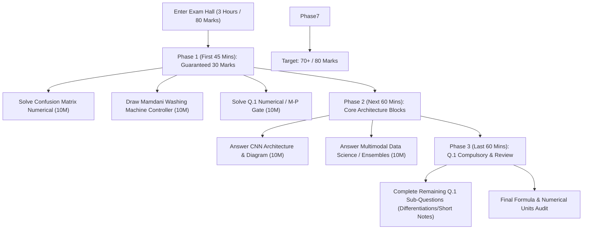

# Artificial Intelligence & Data Science - II (AI & DS II)
## Master Unified Question Bank & High-Yield Priority Guide
**Academic Context:** Mumbai University | B.E. / T.E. Information Technology | Semester VII (R-19 C-Scheme)  
**Subject Code:** 42671  
**Curated Sources:**
1. **MUSA (Mumbai University Students Association) Question Bank & Top 15 (Winter Session 2026)**
2. **Mumbai University 6-Paper PYQ Archive (2023 – 2025: Dec 25, Jun 25, Nov 24, May 24, Dec 23, Jun 23)**

---

## Table of Contents
1. [Master Priority Matrix (Ranked by Recurrence & MUSA Weight)](#1-master-priority-matrix)
2. [Tier 1: Ultra High Frequency (Repeated 6 & 5 Times - Must Solve First)](#2-tier-1-ultra-high-frequency-6x--5x)
3. [Tier 2: Very High Frequency (Repeated 4 Times)](#3-tier-2-very-high-frequency-4x)
4. [Tier 3: High Frequency (Repeated 3 Times)](#4-tier-3-high-frequency-3x)
5. [Tier 4: Moderate Frequency (Repeated 2 Times)](#5-tier-4-moderate-frequency-2x)
6. [Tier 5: Single Appearance & MUSA 2026 Anticipated Questions](#6-tier-5-single-appearance--musa-2026-anticipated)
7. [MUSA Mandatory Section: Tabular Differentiations (Q.23 Part 2)](#7-musa-mandatory-section-tabular-differentiations)
8. [MUSA Mandatory Section: High-Yield Short Notes (Q.24)](#8-musa-mandatory-section-high-yield-short-notes)
9. [Compulsory Numericals & Design Blueprints](#9-compulsory-numericals--design-blueprints)
10. [High-Scoring 80-Mark Exam Strategy](#10-high-scoring-80-mark-exam-strategy)

---

## 1. Master Priority Matrix

This cross-referenced index maps the **repetition frequency across all 6 University examination papers** against the **MUSA Winter 2026 Question Bank** and its official **Top 15 selection**.

| Rank | Topic / Question Description | PYQ Frequency | MUSA QB Ref | MUSA Top 15 Ref | Typical Marks | Priority Status |
| :---: | :--- | :---: | :---: | :---: | :---: | :--- |
| **01** | Classifier Evaluation Metrics & Confusion Matrix | **6 / 6 Papers (100%)** | Q.16 & Num Q.1 | **Top 15 #9** | 10M / 5M | `CRITICAL [Must Solve]` |
| **02** | Convolutional Neural Network (CNN) Architecture | **5 / 6 Papers (83%)** | Q.3 | **Top 15 #2** | 10M | `CRITICAL [Must Solve]` |
| **03** | Data Science for Multimodal Applications | **5 / 6 Papers (83%)** | Q.11 | **Top 15 #10** | 10M | `CRITICAL [Must Solve]` |
| **04** | Bayes' Theorem (Theory, Intuition & Numericals) | **5 / 6 Papers (83%)** | Covered in Q.1 | Top 15 Q.16 Note | 5M | `CRITICAL [Must Solve]` |
| **05** | Mamdani Fuzzy Controller (Washing Machine Design) | **4 / 6 Papers (67%)** | Q.21 | **Top 15 #13** | 10M | `VERY HIGH [Guaranteed]` |
| **06** | Ensemble Methods (Bagging, Boosting, Random Forest, AdaBoost) | **4 / 6 Papers (67%)** | Q.12 & Q.13 | **Top 15 #12** | 10M | `VERY HIGH [Guaranteed]` |
| **07** | Cognitive Systems (Architecture, Components & Design Principles) | **4 / 6 Papers (67%)** | Q.9 & Q.10 | **Top 15 #6 & #11**| 10M | `VERY HIGH [Guaranteed]` |
| **08** | McCulloch-Pitts Neuron Model (AND / XOR Logic & Working) | **4 / 6 Papers (67%)** | Q.24(ii) & Num Q.2 | Top 15 Q.16 Note | 5M / 10M | `VERY HIGH [Guaranteed]` |
| **09** | Defuzzification (Concept, Necessity & Centroid Method) | **4 / 6 Papers (67%)** | Q.7 | **Top 15 #5** | 5M / 10M | `VERY HIGH [Guaranteed]` |
| **10** | Bayesian Belief Networks (BBN) & Inferencing | **3 / 6 Papers (50%)** | Q.1 | **Top 15 #1** | 10M | `HIGH [Core Module 1]` |
| **11** | Taxonomies & Ontologies in Cognitive Systems | **3 / 6 Papers (50%)** | Q.22 | **Top 15 #14** | 10M | `HIGH [Core Module 5]` |
| **12** | Markov Decision Process (MDP) Formulation & Components | **3 / 6 Papers (50%)** | Q.2 | **Top 15 #3** | 5M / 10M | `HIGH [Core Module 1]` |
| **13** | Long Short-Term Memory (LSTM) Architecture & Gating | **3 / 6 Papers (50%)** | Q.8 | **Top 15 #8** | 10M / 5M | `HIGH [Core Module 3]` |
| **14** | Resampling & Validation (Bootstrap, Holdout, Cross-Validation) | **3 / 6 Papers (50%)** | Q.16 & Q.24(iv,v)| Top 15 Q.16 Note | 5M / 10M | `HIGH [Core Module 4]` |
| **15** | Autoencoders for Dimensionality Reduction | **2 / 6 Papers (33%)** | Q.5 | Master QB | 10M | `MODERATE [Core DL]` |
| **16** | Membership Functions & Properties of Fuzzy Sets | **2 / 6 Papers (33%)** | Q.4 | **Top 15 #7** | 10M | `MODERATE [Core Fuzzy]`|
| **17** | Artificial Neural Network (ANN) Architecture & Layers | **2 / 6 Papers (33%)** | Q.6 | **Top 15 #4** | 10M | `MODERATE [Core DL]` |
| **18** | Utility & Expected Utility in Decision Theory | **2 / 6 Papers (33%)** | Q.23 | **Top 15 #15** | 5M | `MODERATE [Core Module 1]`|
| **19** | Deterministic vs Probabilistic Reasoning | **2 / 6 Papers (33%)** | Q.19 | Master QB | 5M | `MODERATE [Core Module 1]`|
| **20** | Comparison: ANN vs RNN | **2 / 6 Papers (33%)** | Q.23(i) | Top 15 Q.16 Note | 5M | `MODERATE [Compulsory Q.1]`|
| **21** | Comparison: Crisp Sets vs Fuzzy Sets | **2 / 6 Papers (33%)** | Q.23(iii) | Top 15 Q.16 Note | 5M | `MODERATE [Compulsory Q.1]`|
| **22** | Comparison: Fuzziness vs Probability | **2 / 6 Papers (33%)** | Q.23(ii) | Top 15 Q.16 Note | 5M | `MODERATE [Compulsory Q.1]`|
| **23** | Neural Activation Functions (ReLU, Sigmoid, Tanh, GELU, etc.) | **2 / 6 Papers (33%)** | Q.17 | Master QB | 5M / 10M | `MODERATE [Core DL]` |
| **24** | Class Imbalance Problem & SMOTE / Sampling Solutions | **2 / 6 Papers (33%)** | Q.20 | Master QB | 10M | `MODERATE [Data Science]`|
| **25** | Role of NLP in Cognitive Architectures | **2 / 6 Papers (33%)** | Q.24(iii) | Top 15 Q.16 Note | 5M / 10M | `MODERATE [Cognitive AI]`|
| **26** | Video Recommendation System Case Study (Data Science) | *MUSA Anticipated* | Q.14 | Master QB | 10M | `NEW [High-Yield Case]`|
| **27** | Industrial Data Science Applications (3 Industries) | *MUSA Anticipated* | Q.18 | Master QB | 10M | `NEW [Applied AI]` |
| **28** | Audio Data Science Trends & Speech Processing | *MUSA Anticipated* | Q.24(i) | Master QB | 5M | `NEW [Short Note]` |

---

## 2. Tier 1: Ultra High Frequency (6x & 5x)

### [Q-01] Classifier Performance Evaluation Metrics & Confusion Matrix Numericals
- **Repetition Frequency:** **6 out of 6 Papers (100% Recurrence)**
- **Exam Appearances:** Dec 2025 (Q.5a, Q.6b), Jun 2025 (Q.5a), Nov 2024 (Q.6a), May 2024 (Q.6a), Dec 2023 (Q.6a), Jun 2023 (Q.1a)
- **MUSA Reference:** Question Bank **Q.16**, **Numerical Q.1**, and **Top 15 #9**
- **Typical Marks:** 10 Marks (often split into 5M theory + 5M numerical, or full 10M numerical)

#### Exact Question Formulations:
1. *MUSA QB Q.16:* "Explain various metrics for evaluating the classifier performance. Discuss any two cross validation methods."
2. *MUSA QB Numerical Q.1:* "Calculate Accuracy, precision, recall, sensitivity and specificity for the following example."
3. *MU May 2024 / Nov 2024 / Dec 2023:* "Consider a binary classification problem for predicting fraudulent vs legitimate transactions. Calculate Accuracy, Precision, Recall, Sensitivity, Specificity, and F1-score given the confusion matrix."

#### Examiner Expected Answers Checklist:
- **Confusion Matrix Layout:**
  - True Positive (TP), True Negative (TN), False Positive (FP - Type I Error), False Negative (FN - Type II Error).
- **Core Formulae (Mandatory to state explicitly before calculating):**
  - $\text{Accuracy} = \frac{TP + TN}{TP + TN + FP + FN}$
  - $\text{Precision} = \frac{TP}{TP + FP}$ *(measures exactness of positive prediction)*
  - $\text{Recall / Sensitivity} = \frac{TP}{TP + FN}$ *(measures completeness of capturing positive cases)*
  - $\text{Specificity} = \frac{TN}{TN + FP}$ *(true negative rate)*
  - $\text{F1-Score} = 2 \times \frac{\text{Precision} \times \text{Recall}}{\text{Precision} + \text{Recall}}$ *(harmonic mean)*
- **Cross-Validation Methods:**
  - **Holdout Method:** Dividing dataset into 70:30 or 80:20 train-test splits.
  - **K-Fold Cross-Validation:** Partitioning dataset into $K$ equal subsets; iterating $K$ times using $K-1$ folds for training and 1 fold for validation.
  - **Stratified K-Fold:** Ensures each fold maintains the same percentage of samples of each target class as the complete dataset.
- **ROC-AUC Overview:** Plot of True Positive Rate ($y$-axis) vs False Positive Rate ($x$-axis) across varying classification thresholds.

---

### [Q-02] Convolutional Neural Network (CNN) Architecture & Applications
- **Repetition Frequency:** **5 out of 6 Papers (83% Recurrence)**
- **Exam Appearances:** Dec 2025 (Q.4a), Jun 2025 (Q.4a), May 2024 (Q.5b), Dec 2023 (Q.3a), Jun 2023 (Q.1b)
- **MUSA Reference:** Question Bank **Q.3** and **Top 15 #2**
- **Typical Marks:** 10 Marks

#### Exact Question Formulations:
1. *MUSA QB Q.3:* "Explain the architecture and components of CNN in detail and state its application also."
2. *MU Dec 2025 / Jun 2025:* "Explain Architecture of CNN in detail. List any two applications of it."
3. *MU May 2024 / Dec 2023:* "Describe the architecture of a typical CNN. What are the main components, and how do they contribute to the network's performance in image recognition tasks?"

#### Examiner Expected Answers Checklist:
- **End-to-End Architectural Diagram:**
  $$\text{Input Image } (32\times32\times3) \longrightarrow [\text{Conv2D} \to \text{ReLU} \to \text{Pooling}] \times N \longrightarrow \text{Flatten} \longrightarrow \text{Dense (FC)} \longrightarrow \text{Softmax}$$
- **Component Breakdown:**
  1. **Input Layer:** Tensor representing pixel intensities ($H \times W \times C$).
  2. **Convolutional Layer:** Learns feature maps via filter kernels, stride ($S$), and zero-padding ($P$). Matrix dot product operation.
  3. **Activation Function (ReLU):** Applies non-linearity $f(x) = \max(0, x)$ to prevent saturation and vanishing gradients.
  4. **Pooling Layer:** Downsamples spatial dimensions (Max Pooling or Average Pooling); reduces parameters and introduces translation invariance.
  5. **Flattening Layer:** Reshapes 2D/3D feature matrices into a 1D feature vector.
  6. **Fully Connected (Dense) Layer:** Combines extracted features for high-level semantic representation.
  7. **Output Layer (Softmax):** Converts logits into multi-class probability distributions $\sigma(z)_i = \frac{e^{z_i}}{\sum e^{z_j}}$.
- **Industrial Applications:** Medical imaging diagnosis (tumors/X-rays), Autonomous vehicle lane detection, Facial verification, Optical Character Recognition (OCR).

---

### [Q-03] Data Science for Multimodal Applications
- **Repetition Frequency:** **5 out of 6 Papers (83% Recurrence)**
- **Exam Appearances:** Dec 2025 (Q.6a), Jun 2025 (Q.6a), May 2024 (Q.6b), Dec 2023 (Q.6b), Jun 2023 (Q.5b)
- **MUSA Reference:** Question Bank **Q.11** and **Top 15 #10**
- **Typical Marks:** 10 Marks

#### Exact Question Formulations:
1. *MUSA QB Q.11:* "Briefly explain Data science for Multimodal applications."
2. *MU Dec 2025 / Jun 2025:* "Explain the role of machine learning in multimodal applications. Discuss how different data modalities (text, audio, image, and video) are integrated to improve performance with real-time applications."

#### Examiner Expected Answers Checklist:
- **Definition:** The convergence of data science algorithms across multiple distinct modalities (text, vision, audio, sensors, tabular data) into a single holistic predictive system.
- **Individual Modalities Covered:**
  - *Text:* NLP, transformer token embeddings, sentiment, intent.
  - *Image/Video:* CNN feature maps, spatial-temporal sequence frames.
  - *Audio:* Mel-spectrograms, MFCC features, acoustic modeling.
- **Multimodal Fusion Strategies (Draw Diagram):**
  1. **Early Fusion (Feature-level):** Concatenating raw feature vectors from all modalities before training the model.
  2. **Late Fusion (Decision-level):** Training independent models for each modality and ensembling output probabilities (weighted voting, averaging).
  3. **Hybrid Fusion:** Intermediate representation alignment via cross-attention layers.
- **Key Challenges:** Temporal misalignment, high dimensionality, missing modality imputation, cross-modal semantic gap.
- **Real-World Case Studies:**
  - Autonomous Driving (Cameras + LiDAR + Radar + Audio).
  - Healthcare Diagnostics (Radiology scans + Patient clinical history notes).
  - Emotion Recognition (Facial expressions + Speech voice tone + Transcript words).

---

### [Q-04] Bayes' Theorem (Theory, Intuition & Numericals)
- **Repetition Frequency:** **5 out of 6 Papers (83% Recurrence)**
- **Exam Appearances:** Dec 2025 (Q.1c, Q.1f), Nov 2024 (Q.1a), May 2024 (Q.1a), Dec 2023 (Q.1a), Jun 2023 (Q.6e)
- **MUSA Reference:** Included in **Q.1** (BBN mathematical engine) & Question Bank Short Note
- **Typical Marks:** 5 Marks (Core Compulsory Q.1)

#### Exact Question Formulations:
1. *MU Dec 2025 (Q.1c):* "How does Bayes Theorem determines the probability of an event with uncertain knowledge? Give one example."
2. *MU Dec 2025 (Q.1f - Numerical):* "A medical test for a disease is 99% accurate. The disease affects 1 in 10,000 people. Calculate the probability that a person who tests positive actually has the disease."
3. *MU May 2024 (Q.1a - Numerical):* "From a deck of cards, single card drawn. $P(\text{King}) = 4/52$. Calculate posterior $P(\text{King}|\text{Face})$."

#### Examiner Expected Answers Checklist:
- **Mathematical Formula:**
  $$P(H|E) = \frac{P(E|H) \cdot P(H)}{P(E)}$$
- **Terms Defined:**
  - $P(H)$: Prior probability of hypothesis before seeing evidence.
  - $P(E|H)$: Likelihood of observing evidence $E$ given hypothesis $H$ holds true.
  - $P(E)$: Marginal probability of evidence across all hypotheses: $P(E) = \sum P(E|H_i)P(H_i)$.
  - $P(H|E)$: Posterior probability of hypothesis given evidence.
- **Full Solved Numerical Example:** (See Section 9 for step-by-step solution to the 99% medical test).

---

## 3. Tier 2: Very High Frequency (4x)

### [Q-05] Mamdani Fuzzy Logic Controller (Washing Machine System Design)
- **Repetition Frequency:** **4 out of 6 Papers (67% Recurrence)**
- **Exam Appearances:** Dec 2025 (Q.3b), Jun 2025 (Q.3b), May 2024 (Q.4a), Jun 2023 (Q.4a)
- **MUSA Reference:** Question Bank **Q.21** and **Top 15 #13**
- **Typical Marks:** 10 Marks

#### Exact Question Formulation:
> "Using Mamdani fuzzy model design a fuzzy logic controller to determine the wash time of domestic washing machine. Assume the inputs are dirt and grease on clothes. Use three descriptors for each input variable and five descriptor for output variables. Derive necessary membership functions and required fuzzy rules for the application."

#### Step-by-Step Examiner Design Blueprint:
1. **Variable Specification:**
   - **Input 1: Dirt Level (Range 0 – 100):** Descriptors: `Low`, `Medium`, `High`.
   - **Input 2: Grease Level (Range 0 – 100):** Descriptors: `Low`, `Medium`, `High`.
   - **Output: Wash Time (Range 0 – 60 mins):** Descriptors: `Very Short (VS)`, `Short (S)`, `Medium (M)`, `Long (L)`, `Very Long (VL)`.
2. **Membership Function Graph:**
   - Draw Triangular/Trapezoidal curves for Dirt (0-40, 20-80, 60-100).
   - Draw curves for Grease (0-40, 20-80, 60-100).
   - Draw 5 staggered triangles for Wash Time (0-15m, 10-25m, 20-40m, 35-50m, 45-60m).
3. **Fuzzy Rule Base Matrix ($3 \times 3 = 9$ Rules):**
   | Dirt \ Grease | Low | Medium | High |
   | :--- | :---: | :---: | :---: |
   | **Low** | Very Short | Short | Medium |
   | **Medium** | Short | Medium | Long |
   | **High** | Medium | Long | Very Long |
4. **4-Stage Execution Architecture:**
   $$\text{Crisp Inputs} \xrightarrow{\text{Fuzzification}} \text{Fuzzy Inputs} \xrightarrow[\text{MIN Operator}]{\text{Rule Evaluation}} \text{Firing Strengths} \xrightarrow[\text{MAX Operator}]{\text{Aggregation}} \text{Fuzzy Output} \xrightarrow[\text{Centroid / COA}]{\text{Defuzzification}} \text{Crisp Wash Time}$$

---

### [Q-06] Ensemble Methods (Bagging, Boosting, Random Forest & AdaBoost)
- **Repetition Frequency:** **4 out of 6 Papers (67% Recurrence)**
- **Exam Appearances:** Dec 2025 (Q.5b), Jun 2025 (Q.5b), Nov 2024 (Q.2a), May 2024 (Q.2a), Dec 2023 (Q.2a), Jun 2023 (Q.2b)
- **MUSA Reference:** Question Bank **Q.12**, **Q.13**, **Q.23(iv)**, and **Top 15 #12**
- **Typical Marks:** 10 Marks

#### Exact Question Formulation:
> "How Bagging and Boosting handle bias-variance trade-off differently, and analyze their effectiveness in dealing with noisy data and overfitting. Explain with algorithms such as Random Forest and AdaBoost."

#### Examiner Expected Answers Checklist:
- **Bias-Variance Decomposition:**
  - **Bagging (Bootstrap Aggregating):** Trains multiple base learners in parallel on independent bootstrap samples. Reduces **Variance** (prevents overfitting). High bias models will not benefit; requires low-bias, high-variance learners (unpruned Decision Trees).
  - **Boosting:** Trains base learners sequentially. Each new learner concentrates on misclassified instances from previous models by adjusting sample weights. Reduces **Bias**.
- **Dealing with Noisy Data:**
  - *Bagging* is robust to noise because out-of-bag averaging dampens outliers.
  - *Boosting* is highly sensitive to noise because mislabeled outliers get compounded higher weights in subsequent iterations, leading to overfitting.
- **Random Forest Mechanics:** Combines Bagging with **Random Feature Subspace selection** (at each node split, chooses best feature among $\sqrt{p}$ features). Pruning is not necessary.
- **AdaBoost Mechanics:** Starts with equal weights $w_i = 1/N$. Misclassified error $\epsilon_t = \sum w_i$. Model weight $\alpha_t = \frac{1}{2} \ln(\frac{1-\epsilon_t}{\epsilon_t})$. Updates sample weights: $w_{i} \leftarrow w_i \cdot e^{\pm \alpha_t}$.

---

### [Q-07] Cognitive Systems (Architecture, Components & Design Principles)
- **Repetition Frequency:** **4 out of 6 Papers (67% Recurrence)**
- **Exam Appearances:** Dec 2025 (Q.2a), Nov 2024 (Q.2b), May 2024 (Q.5a), Dec 2023 (Q.5a), Jun 2023 (Q.3b)
- **MUSA Reference:** Question Bank **Q.9**, **Q.10**, and **Top 15 #6 & #11**
- **Typical Marks:** 10 Marks

#### Exact Question Formulations:
1. *MUSA QB Q.10:* "Define Cognitive computing. Draw a neat diagram of components of the cognitive system and explain the components also List and explain the design principle of Cognitive system."
2. *MUSA QB Q.9:* "What is cognitive computing, and how does it differ from traditional computing? List and explain the process of building a cognitive application."

#### Examiner Expected Answers Checklist:
- **Definition:** Systems that simulate human thought processes, understanding unstructured data, reasoning probabilistically, and learning through interactions.
- **Cognitive System Architecture Diagram:**
  $$\text{Data Sources (Docs, Sensors, Social)} \longrightarrow \text{Ingestion \& Cleaning} \longrightarrow \begin{bmatrix} \textbf{Cognitive Engine} \\ \text{Ontologies / Knowledge Bases} \\ \text{Machine Learning / Deep Learning} \\ \text{NLP \& Speech / Vision Perception} \\ \text{Evidence Reasoning} \end{bmatrix} \longrightarrow \begin{matrix} \text{Insights} \\ \text{Predictions} \\ \text{Decisions} \end{matrix}$$
- **Key Design Principles (List 5 to 10):**
  1. *Human-Centric & Interactive:* Augments human decision-making, not just automation.
  2. *Adaptive:* Learns from continuous changes in information and goals.
  3. *Stateful & Contextual:* Understands context, syntax, culture, time, and user intent.
  4. *Handling Uncertainty:* Employs probabilistic reasoning over deterministic black-or-white rules.
  5. *Continuous Improvement:* Feedback loop updates models over time.
- **Cognitive vs Traditional Computing:**
  | Dimension | Traditional Computing | Cognitive Computing |
  | :--- | :--- | :--- |
  | **Logic** | Rigid, deterministic, rule-based | Probabilistic, adaptive, learning |
  | **Data Type** | Highly structured (RDBMS, CSV) | Unstructured (Audio, Video, PDF, Natural Language) |
  | **Output** | Exact numerical or binary result | Confidence-weighted recommendations |

---

### [Q-08] McCulloch-Pitts Neuron Model (AND / XOR Logic Gate Implementations)
- **Repetition Frequency:** **4 out of 6 Papers (67% Recurrence)**
- **Exam Appearances:** Jun 2025 (Q.1a), Nov 2024 (Q.1c), Dec 2023 (Q.1c), Jun 2023 (Q.2a - 10M)
- **MUSA Reference:** Question Bank **Q.24(ii)**, **Numerical Q.2**, and Top 15 Mandatory Note
- **Typical Marks:** 5 Marks (compulsory Q.1) or 10 Marks (full multi-gate derivation)

#### Technical Implementation Details:
- **Neuron Mathematical Model:**
  $$I = \sum_{i=1}^n w_i x_i, \quad y = f(I) = \begin{cases} 1 & \text{if } I \ge \theta \\ 0 & \text{if } I < \theta \end{cases}$$
- **AND Gate Implementation (Linearly Separable):**
  - Inputs: $x_1, x_2 \in \{0, 1\}$.
  - Assign equal excitatory weights: $w_1 = 1, w_2 = 1$.
  - Threshold: $\theta = 2$.
  - Truth table verification:
    - $(0,0) \to 0 < 2 \implies 0$
    - $(0,1) \to 1 < 2 \implies 0$
    - $(1,0) \to 1 < 2 \implies 0$
    - $(1,1) \to 2 \ge 2 \implies 1$ (Verified).
- **XOR Gate Implementation (Non-Linearly Separable):**
  - Single M-P neuron fails because XOR cannot be separated by a single linear decision boundary.
  - Requires a 2-layer network decomposing XOR into: $y = (x_1 \land \neg x_2) \lor (\neg x_1 \land x_2)$.
  - Uses inhibitory weights ($w = -1$) for negated inputs.

---

### [Q-09] Defuzzification (Concept, Necessity & Centroid Method)
- **Repetition Frequency:** **4 out of 6 Papers (67% Recurrence)**
- **Exam Appearances:** May 2024 (Q.1b), Dec 2023 (Q.1b), Jun 2023 (Q.6c), Nov 2024 (Q.3a)
- **MUSA Reference:** Question Bank **Q.7** and **Top 15 #5**
- **Typical Marks:** 5 Marks / 10 Marks

#### Exact Question Formulation:
> "Define Defuzzification. Discuss any two methods of defuzzification?"

#### Examiner Expected Answers Checklist:
- **Definition:** The mathematical procedure of converting a combined fuzzy membership set into a single, exact crisp value.
- **Necessity:** Hardware actuators, mechanical switches, valves, and control registers cannot execute fuzzy advice ("lukewarm", "medium speed"); they require single scalar inputs (e.g., $38.5^\circ\text{C}$, $4.2\text{V}$).
- **Two Major Methods:**
  1. **Centroid Method (Center of Gravity / COG):**
     $$z^* = \frac{\int z \cdot \mu_A(z) \, dz}{\int \mu_A(z) \, dz} \quad \text{or for discrete: } z^* = \frac{\sum z \cdot \mu_A(z)}{\sum \mu_A(z)}$$
     - *Advantages:* Highly balanced, takes entire fuzzy output surface into account, smooth continuous response.
     - *Disadvantages:* Computationally expensive for complex geometric shapes.
  2. **Mean of Maximum (MOM):**
     $$z^* = \frac{\sum_{i=1}^k z_i}{k} \quad \text{where } \mu_A(z_i) = \mu_{\max}$$
     - *Advantages:* Very fast, low computational complexity.
     - *Disadvantages:* Ignores the overall shape of the membership distribution outside the peak.

---

## 4. Tier 3: High Frequency (3x)

### [Q-10] Bayesian Belief Networks (BBN) & Inferencing
- **Repetition Frequency:** **3 out of 6 Papers (50% Recurrence)**
- **Exam Appearances:** Jun 2025 (Q.4b), Nov 2024 (Q.4b), Dec 2023 (Q.4b)
- **MUSA Reference:** Question Bank **Q.1** and **Top 15 #1**
- **Typical Marks:** 10 Marks

#### Exact Question Formulation:
> "What is Bayesian Belief Network? Explain Interfacing / Inferencing in detail with example."

#### Examiner Expected Answers Checklist:
- **Definition:** A Directed Acyclic Graph (DAG) whose nodes represent random variables and directed edges represent conditional causal dependencies, paired with a Conditional Probability Table (CPT) for each node.
- **Joint Distribution Formula:**
  $$P(X_1, X_2, \dots, X_n) = \prod_{i=1}^n P(X_i \mid \text{Parents}(X_i))$$
- **Standard Example (Rain $\to$ Wet Grass / Sprinkler):**
  - Draw DAG with nodes: Rain, Sprinkler, Wet Grass.
  - Show CPT tables: Prior $P(\text{Rain}) = 0.2$, Conditional $P(\text{Wet Grass} \mid \text{Rain})$.
- **Inference Types:**
  1. *Diagnostic Inference:* Reasoning from symptoms to causes ($P(\text{Disease} \mid \text{Symptom})$).
  2. *Causal Inference:* Reasoning from causes to effects ($P(\text{Symptom} \mid \text{Disease})$).
  3. *Intercausal Inference (Explaining Away):* Between multiple causes sharing a common symptom.

---

### [Q-11] Knowledge Representation: Taxonomies & Ontologies
- **Repetition Frequency:** **3 out of 6 Papers (50% Recurrence)**
- **Exam Appearances:** Dec 2025 (Q.2b), Jun 2025 (Q.2b), Dec 2023 (Q.2b)
- **MUSA Reference:** Question Bank **Q.22** and **Top 15 #14**
- **Typical Marks:** 10 Marks

#### Exact Question Formulation:
> "Explain the role of representing knowledge in taxonomies and ontologies, and how advanced analytics can be applied to cognitive systems."

#### Examiner Expected Answers Checklist:
- **Taxonomies:**
  - Tree-structured hierarchical classifications based solely on parent-child `is-a` relationships (e.g., Living Thing $\to$ Animal $\to$ Mammal $\to$ Dog).
  - Organizes enterprise unstructured files into structured categories.
- **Ontologies:**
  - Graph-based formal semantic representations containing entities, classes, multi-directional attributes, relationships (`part-of`, `treated-by`, `causes`), and formal logic axioms.
  - Built using standards like RDF, RDFS, and OWL.
- **Role in Cognitive Systems:**
  - Provides domain context for disambiguating human queries in NLP pipelines.
  - Enables automated logical reasoning and inferring implicit facts from explicit data.
- **Advanced Analytics Integration:**
  - Graph Neural Networks (GNN) and Knowledge Graph Embeddings (TransE) applied on ontologies to predict new relationships (e.g., drug-target interactions, fraud networks).

---

### [Q-12] Markov Decision Process (MDP)
- **Repetition Frequency:** **3 out of 6 Papers (50% Recurrence)**
- **Exam Appearances:** Dec 2025 (Q.1e), May 2024 (Q.4b), Jun 2023 (Q.3a)
- **MUSA Reference:** Question Bank **Q.2** and **Top 15 #3**
- **Typical Marks:** 5 Marks / 10 Marks

#### Exact Question Formulation:
> "What is a Markov Decision Process (MDP)? List its primary components and need of MDP in detail."

#### Examiner Expected Answers Checklist:
- **Definition:** A formal mathematical framework for modeling decision-making in environments where outcomes are partly random and partly under the control of a decision-maker.
- **The 5-Tuple Formulation $(S, A, P, R, \gamma)$:**
  1. $S$: Finite set of environmental states.
  2. $A$: Finite set of available actions.
  3. $P$: State transition probability matrix $P(s' \mid s, a) = \mathbb{P}(S_{t+1}=s' \mid S_t=s, A_t=a)$.
  4. $R$: Reward function $R(s, a, s')$ returned after transitioning.
  5. $\gamma$: Discount factor ($\gamma \in [0, 1]$), valuing immediate rewards over distant future rewards.
- **Markov Property:** Future states depend strictly on the current state and action, independent of the historical path:
  $$\mathbb{P}(S_{t+1} \mid S_t, A_t, S_{t-1}, A_{t-1}, \dots) = \mathbb{P}(S_{t+1} \mid S_t, A_t)$$
- **Bellman Equation:**
  $$V^*(s) = \max_a \sum_{s'} P(s' \mid s, a) \left[ R(s, a, s') + \gamma V^*(s') \right]$$

---

### [Q-13] Long Short-Term Memory (LSTM) Networks
- **Repetition Frequency:** **3 out of 6 Papers (50% Recurrence)**
- **Exam Appearances:** Dec 2025 (Q.4b), Nov 2024 (Q.5b), Jun 2023 (Q.6b)
- **MUSA Reference:** Question Bank **Q.8** and **Top 15 #8**
- **Typical Marks:** 10 Marks / 5 Marks

#### Exact Question Formulation:
> "What are all the objects of using LSTM? Explain its architecture."

#### Examiner Expected Answers Checklist:
- **Why LSTM is Needed:** Standard Recurrent Neural Networks (RNN) suffer from the **Vanishing Gradient Problem** during backpropagation through time (BPTT), making them incapable of learning long-term temporal dependencies beyond 10-15 time steps.
- **Core Structural Innovation:** The horizontal **Cell State line ($C_t$)**, acting as a conveyor belt carrying memory across arbitrary time intervals with minimal linear interaction.
- **The 3 Internal Gating Mechanisms (Draw Complete Cell Diagram with Formulas):**
  1. **Forget Gate ($f_t$):** Decides what irrelevant information to discard from cell state:
     $$f_t = \sigma(W_f \cdot [h_{t-1}, x_t] + b_f)$$
  2. **Input Gate ($i_t, \tilde{C}_t$):** Decides what new candidate values to store:
     $$i_t = \sigma(W_i \cdot [h_{t-1}, x_t] + b_i), \quad \tilde{C}_t = \tanh(W_c \cdot [h_{t-1}, x_t] + b_c)$$
     $$\text{Updated Cell State: } C_t = f_t \odot C_{t-1} + i_t \odot \tilde{C}_t$$
  3. **Output Gate ($o_t$):** Decides what to output based on the filtered cell state:
     $$o_t = \sigma(W_o \cdot [h_{t-1}, x_t] + b_o), \quad h_t = o_t \odot \tanh(C_t)$$

---

### [Q-14] Resampling & Validation Methods (Bootstrap, Holdout & Cross-Validation)
- **Repetition Frequency:** **3 out of 6 Papers (50% Recurrence)**
- **Exam Appearances:** Dec 2025 (Q.5a), Nov 2024 (Q.1d), Jun 2023 (Q.6a)
- **MUSA Reference:** Question Bank **Q.16**, **Q.24(iv, v)**, and Top 15 Q.16 Note
- **Typical Marks:** 5 Marks

#### Key Technical Principles:
- **Holdout Method:** Fixed partitioning (e.g., 80% train, 20% test). Fast, but results vary wildly depending on which samples fall into test set.
- **Bootstrap Sampling:** Resampling with replacement from dataset of size $N$. Probability of a sample NOT being chosen in $N$ draws is $\lim_{N\to\infty} (1 - 1/N)^N = 1/e \approx 36.8\%$. Thus, each bootstrap sample contains $\approx 63.2\%$ unique original data points; remaining $\approx 36.8\%$ form the **Out-Of-Bag (OOB)** validation set.
- **Random Subsampling:** Repeated holdout splits averaged over $M$ iterations.

---

## 5. Tier 4: Moderate Frequency (2x)

### [Q-15] Autoencoders for Dimensionality Reduction
- **Repetition Frequency:** **2 out of 6 Papers (33%)**
- **Exam Appearances:** May 2024 (Q.3a), Jun 2023 (Q.4b)
- **MUSA Reference:** Question Bank **Q.5**
- **Typical Marks:** 10 Marks
- **Key Answers Checklist:** Hourglass architecture; Encoder compresses $x \to z$; Latent bottleneck represents low-dimensional code; Decoder reconstructs $\hat{x} \approx x$; Objective is minimizing Reconstruction Loss $\mathcal{L}(x, \hat{x}) = \|x - \hat{x}\|^2$; Captures non-linear relationships compared to linear PCA.

---

### [Q-16] Fuzzy Membership Functions & Properties of Fuzzy Sets
- **Repetition Frequency:** **2 out of 6 Papers (33%)**
- **Exam Appearances:** Dec 2025 (Q.3a), May 2024 (Q.3b)
- **MUSA Reference:** Question Bank **Q.4** and **Top 15 #7**
- **Typical Marks:** 10 Marks
- **Key Answers Checklist:**
  - *Membership Functions (Draw Curves):* Triangular, Trapezoidal, Gaussian, Sigmoidal, Singleton.
  - *Fuzzy Set Properties:* Support $\{x \mid \mu(x) > 0\}$, Core $\{x \mid \mu(x) = 1\}$, Boundary $\{x \mid 0 < \mu(x) < 1\}$, Normality ($\max \mu(x) = 1$), Convexity, Union ($\max$), Intersection ($\min$), Complement ($1 - \mu(x)$).

---

### [Q-17] Artificial Neural Network (ANN) Architecture & Layers
- **Repetition Frequency:** **2 out of 6 Papers (33%)**
- **Exam Appearances:** Nov 2024 (Q.3b), Dec 2023 (Q.4a)
- **MUSA Reference:** Question Bank **Q.6** and **Top 15 #4**
- **Typical Marks:** 10 Marks
- **Key Answers Checklist:** Input, Hidden, and Output layers; Weights ($W$), Biases ($b$), and non-linear activation functions; Forward propagation $z = Wx + b, a = f(z)$; Loss computation and Backpropagation gradient descent weight updates $\Delta W = -\eta \frac{\partial \mathcal{L}}{\partial W}$.

---

### [Q-18] Utility & Expected Utility in Decision Theory
- **Repetition Frequency:** **2 out of 6 Papers (33%)**
- **Exam Appearances:** Dec 2025 (Q.1a), Jun 2025 (Q.1e)
- **MUSA Reference:** Question Bank **Q.23** and **Top 15 #15**
- **Typical Marks:** 5 Marks
- **Key Answers Checklist:** Utility measures preference of an agent for a state; Principle of Maximum Expected Utility (MEU): Rational agent chooses action maximizing $EU(A) = \sum P(O_i \mid A) \cdot U(O_i)$; Investment decision payoff matrix example.

---

### [Q-19] Deterministic Approaches vs Probabilistic Reasoning
- **Repetition Frequency:** **2 out of 6 Papers (33%)**
- **Exam Appearances:** Dec 2025 (Q.1b), Jun 2025 (Q.1b)
- **MUSA Reference:** Question Bank **Q.19**
- **Typical Marks:** 5 Marks
- **Key Answers Checklist:** Limitations of deterministic logic: Qualification problem, partial observability, sensor noise, unpredictable environments; Probabilistic reasoning handles uncertainty via belief states, Bayes rule, and likelihood updating.

---

### [Q-20] Neural Activation Functions
- **Repetition Frequency:** **2 out of 6 Papers (33%)**
- **Exam Appearances:** Nov 2024 (Q.4a), Jun 2023 (Q.5a)
- **MUSA Reference:** Question Bank **Q.17**
- **Typical Marks:** 5 Marks / 10 Marks
- **Key Answers Checklist:** Binary step, Linear, Sigmoid ($1/(1+e^{-x})$), Tanh, ReLU ($\max(0,x)$), Leaky ReLU ($\max(\alpha x, x)$), Softmax, and modern Transformer activations (GELU, Swish). Must include formulas and 2D activation graphs.

---

### [Q-21] Class Imbalance Problem & Mitigation Techniques
- **Repetition Frequency:** **2 out of 6 Papers (33%)**
- **Exam Appearances:** Dec 2025 (Q.5a), Jun 2023 (Q.2a)
- **MUSA Reference:** Question Bank **Q.20**
- **Typical Marks:** 10 Marks
- **Key Answers Checklist:** Why standard accuracy fails on imbalanced data (99% majority class gives 99% accuracy while detecting 0 frauds); Solutions: Random Oversampling, Random Undersampling, SMOTE (Synthetic Minority Over-sampling Technique via interpolation), Cost-Sensitive Learning / Class Weighting, Precision-Recall threshold tuning.

---

## 6. Tier 5: Single Appearance & MUSA 2026 Anticipated

These questions appeared once in the past papers or represent **novel priority questions formulated in the MUSA Winter 2026 Question Bank**:

1. **[Q-22] Case Study on Video Recommendation Systems (MUSA QB Q.14 - 10 Marks):**
   - Data collection (clicks, watch time, skips, search terms).
   - Candidate Generation (Collaborative Filtering, Matrix Factorization).
   - Ranking Stage (Deep Neural Network scoring candidates with CTR and retention objectives).
   - Handling cold start via content-based metadata (tags, audio analysis).
2. **[Q-23] Three Industries Where Data Science is Extensively Used (MUSA QB Q.18 - 10 Marks):**
   - Healthcare (Disease diagnosis from CT scans, drug discovery).
   - Banking & Financial Services (Fraud detection, credit risk scoring, algorithmic trading).
   - E-commerce / Retail (Demand forecasting, churn prediction, personalized recommendations).
3. **[Q-24] Concept & Applications of Deep Learning (MUSA QB Q.15 - 10 Marks):**
   - Hierarchical feature extraction from raw data without manual feature engineering.
   - Applications: Computer vision, Speech-to-text, NLP, Autonomous navigation.
4. **[Q-25] Trends in Audio Data Science (MUSA QB Q.24(i) - 5 Marks):**
   - Automatic Speech Recognition (ASR), Speech Emotion Recognition (SER), Sound Event Detection (SED), Voice Cloning, Mel-spectrogram processing via CNNs.
5. **[Q-26] Role of NLP in Cognitive Architectures (MUSA QB Q.24(iii) - 5 Marks):**
   - Semantic parsing, intent detection, named entity recognition (NER), knowledge graph grounding, and contextual conversational memory.
6. **[Q-27] Significance of ROC Curves (MUSA QB Q.24(vi) - 5 Marks):**
   - Tradeoff between Sensitivity (TPR) and $1 - \text{Specificity}$ (FPR); threshold-independent performance evaluation; Area Under Curve (AUC) interpretation.

---

## 7. MUSA Mandatory Section: Tabular Differentiations

*Directly maps to MUSA Question Bank Q.23 Part 2 (Crucial for Question 1 Compulsory 5-Mark Questions)*:

### 1. ANN vs RNN
| Parameter / Basis | Artificial Neural Network (ANN) | Recurrent Neural Network (RNN) |
| :--- | :--- | :--- |
| **Architecture** | Strictly feedforward; acyclic connections | Cyclic connections with directed feedback loops |
| **Temporal Memory** | No internal memory of past inputs | Internal hidden state ($h_t$) retains sequential memory |
| **Input Data Type** | Fixed-dimension independent samples (tabular, images) | Variable-length sequential / time-series data (speech, text) |
| **Gradient Flow** | Standard Backpropagation | Backpropagation Through Time (BPTT) |
| **Vulnerability** | Vulnerable to vanishing gradients in deep layers | Highly susceptible to both vanishing and exploding gradients |

### 2. Fuzziness vs Probability
| Parameter / Basis | Fuzziness (Fuzzy Logic) | Probability Theory |
| :--- | :--- | :--- |
| **Nature of Uncertainty** | Vagueness and ambiguity in deterministic facts | Likelihood of occurrence of an uncertain event |
| **Question Addressed** | "To what degree is this bottle full?" | "Is this bottle full or empty?" |
| **Meaning of Value 0.6** | The bottle is 60% full (degree of membership $\mu = 0.6$) | 60% chance that the bottle is completely full |
| **Underlying Law** | Can violate Law of Excluded Middle ($A \cup \bar{A} \ne 1$) | Strict compliance with Kolmogorov Axioms ($\sum P = 1$) |

### 3. Crisp Sets vs Fuzzy Sets
| Parameter / Basis | Crisp Set (Classical Logic) | Fuzzy Set |
| :--- | :--- | :--- |
| **Membership Values** | Binary: $\mu_A(x) \in \{0, 1\}$ | Continuous interval: $\mu_A(x) \in [0, 1]$ |
| **Boundary** | Strict, sharp, and unambiguous | Gradual, smooth, and shaded transition boundary |
| **Mathematical Logic** | Boolean logic (True / False) | Multi-valued fuzzy logic |
| **Applications** | Digital electronics, classical database queries | Natural language processing, washing machines, robotics |

### 4. Bagging vs Boosting
| Parameter / Basis | Bagging (Bootstrap Aggregation) | Boosting |
| :--- | :--- | :--- |
| **Model Generation** | Parallel independent training | Sequential dependent training |
| **Primary Goal** | Reduces **Variance** (prevents overfitting) | Reduces **Bias** (converts weak learners to strong) |
| **Data Weighting** | All samples have equal uniform weight | Misclassified instances receive iteratively higher weights |
| **Base Learners** | Complex, high-variance learners (Deep Trees) | Simple, high-bias learners (Decision Stumps) |
| **Example Algorithm** | Random Forest | AdaBoost, Gradient Boost, XGBoost |

---

## 8. MUSA Mandatory Section: High-Yield Short Notes

*Directly maps to MUSA Question Bank Q.24 (Targeting Question 1 Sub-Questions)*:

1. **Trends in Data Science for Audio (Q.24(i)):**
   - Raw waveform vs Fourier representation (Spectrograms).
   - Acoustic feature extraction: Mel-Frequency Cepstral Coefficients (MFCC), Chroma features.
   - Applications: Whisper ASR, Voice biometric authentication, Audio classification.
2. **McCulloch-Pitts Neuron with Example (Q.24(ii)):**
   - 1943 foundational model by Warren McCulloch and Walter Pitts.
   - Summation over weighted inputs compared against a threshold $\theta$.
   - Verified implementation of basic logic gates (AND, OR, NOT).
3. **NLP in Support of Cognitive Systems (Q.24(iii)):**
   - Converts natural human dialogue into semantic representations.
   - Syntactic analysis $\to$ Semantic parsing $\to$ Pragmatic context grounding.
   - Powers enterprise cognitive assistants (e.g., IBM Watson in oncology).
4. **Bootstrap for Sampling (Q.24(iv)):**
   - Resampling with replacement technique to estimate confidence intervals and standard errors.
   - Approximately $63.2\%$ sample retention and $36.8\%$ Out-of-Bag (OOB) instances.
5. **Holdout Method and Random Subsampling (Q.24(v)):**
   - Partitioning strategies for empirical machine learning evaluation.
   - Train/Test splits; addressing data leakage and sample variance.
6. **Significance of ROC Curves (Q.24(vi)):**
   - Plots Sensitivity (TPR) vs $1 - \text{Specificity}$ (FPR).
   - Allows optimal threshold selection depending on business costs of False Positives vs False Negatives.

---

## 9. Compulsory Numericals & Design Blueprints

### 1. Confusion Matrix Evaluation: All University PYQ Numericals Solved

#### PYQ Numerical A: Dec 2023 Paper (QP Code: 10038602, Q.6a - 10 Marks)
**Exam Problem Statement:**  
Calculate Accuracy, Precision, Recall, Sensitivity and Specificity for the following example:

| Predicted Class \ Actual Class | **Buys_Computer = yes (+)** | **Buys_Computer = no (-)** |
| :--- | :---: | :---: |
| **Buys_Computer = yes (+)** | 6954 | 46 |
| **Buys_Computer = no (-)** | 412 | 2588 |

**Step 0: Identify the 4 Core Values:**
- $\text{True Positive (TP)} = \mathbf{6954}$ *(Actual Yes, Predicted Yes)*
- $\text{False Positive (FP)} = \mathbf{46}$ *(Actual No, Predicted Yes - False Alarm)*
- $\text{False Negative (FN)} = \mathbf{412}$ *(Actual Yes, Predicted No)*
- $\text{True Negative (TN)} = \mathbf{2588}$ *(Actual No, Predicted No)*
- $\text{Total } (N) = 6954 + 46 + 412 + 2588 = \mathbf{10,000}$

**Calculations:**
1. **Accuracy:**
   $$\text{Accuracy} = \frac{TP + TN}{\text{Total}} = \frac{6954 + 2588}{10000} = \frac{9542}{10000} = \mathbf{0.9542 \ (95.42\%)}$$
2. **Precision:**
   $$\text{Precision} = \frac{TP}{TP + FP} = \frac{6954}{6954 + 46} = \frac{6954}{7000} = \mathbf{0.9934 \ (99.34\%)}$$
3. **Recall (Sensitivity):**
   $$\text{Recall} = \frac{TP}{TP + FN} = \frac{6954}{6954 + 412} = \frac{6954}{7366} = \mathbf{0.9441 \ (94.41\%)}$$
   $$\mathbf{\text{Sensitivity} = \text{Recall} = 94.41\%}$$
4. **Specificity:**
   $$\text{Specificity} = \frac{TN}{TN + FP} = \frac{2588}{2588 + 46} = \frac{2588}{2634} = \mathbf{0.9825 \ (98.25\%)}$$

---

#### PYQ Numerical B: Nov 2024 Paper (QP Code: 10067845, Q.6a - 10 Marks)
**Exam Problem Statement:**  
Define Accuracy, Precision, and Recall. Evaluate the performance of **Classifier 1** and **Classifier 2** on the basis of the above evaluation parameters, given following confusion matrix where $F = \text{actual fraud}$, $F' = \text{predicted fraud}$, $N = \text{actual no fraud}$, $N' = \text{predicted no fraud}$:

**Classifier 1 Matrix:**
| | **$F'$ (Pred Fraud)** | **$N'$ (Pred No Fraud)** |
| :--- | :---: | :---: |
| **$F$ (Actual Fraud)** | 20 | 10 |
| **$N$ (Actual No Fraud)**| 10 | 60 |

**Classifier 2 Matrix:**
| | **$F'$ (Pred Fraud)** | **$N'$ (Pred No Fraud)** |
| :--- | :---: | :---: |
| **$F$ (Actual Fraud)** | 0 | 15 |
| **$N$ (Actual No Fraud)**| 5 | 80 |

**Part 1: Definitions (Mandatory 3 Marks):**
- **Accuracy:** Proportion of all correct decisions made by the classifier: $\frac{TP + TN}{Total}$.
- **Precision:** Exactness of positive predictions: $\frac{TP}{TP + FP}$.
- **Recall:** Completeness of capturing true positive instances: $\frac{TP}{TP + FN}$.

**Part 2: Classifier 1 Evaluation ($N = 20 + 10 + 10 + 60 = 100$):**
- $TP = 20, FN = 10, FP = 10, TN = 60$
- $\text{Accuracy}_1 = \frac{20 + 60}{100} = \mathbf{80\%}$
- $\text{Precision}_1 = \frac{20}{20 + 10} = \frac{20}{30} = \mathbf{66.67\%}$
- $\text{Recall}_1 = \frac{20}{20 + 10} = \frac{20}{30} = \mathbf{66.67\%}$

**Part 3: Classifier 2 Evaluation ($N = 0 + 15 + 5 + 80 = 100$):**
- $TP = 0, FN = 15, FP = 5, TN = 80$
- $\text{Accuracy}_2 = \frac{0 + 80}{100} = \mathbf{80\%}$
- $\text{Precision}_2 = \frac{0}{0 + 5} = \mathbf{0\%}$
- $\text{Recall}_2 = \frac{0}{0 + 15} = \mathbf{0\%}$

**Part 4: Comparison & Conclusion (2 Marks):**
| Parameter | Classifier 1 | Classifier 2 | Winner / Decision |
| :--- | :---: | :---: | :---: |
| **Accuracy** | 80% | 80% | Identical / Tie |
| **Precision** | **66.67%** | 0% | **Classifier 1** |
| **Recall** | **66.67%** | 0% | **Classifier 1** |

> **Conclusion Statement:** While both classifiers exhibit identical 80% accuracy, **Classifier 2 is completely non-functional for fraud detection** as it failed to detect a single fraudulent transaction ($Recall = 0\%$). **Classifier 1 is overwhelmingly superior**, proving that accuracy alone is a misleading metric for imbalanced datasets.

---

#### PYQ Numerical C: May 2024 Paper (QP Code: 10056808, Q.6a - 10 Marks)
**Exam Problem Statement:**  
Consider a binary classification problem for transaction fraud detection. After testing on a dataset, we obtain:

| | **Actual Legitimate (-)** | **Actual Fraudulent (+)** |
| :--- | :---: | :---: |
| **Predicted Legitimate (-)** | 850 | 30 |
| **Predicted Fraudulent (+)** | 20 | 100 |

Calculate Accuracy, Precision, Recall, and F1-score.

**Values:** $TN = 850, FP = 20, FN = 30, TP = 100, \text{Total} = 1000$.

**Calculations:**
$$\text{Accuracy} = \frac{TP + TN}{\text{Total}} = \frac{100 + 850}{1000} = \frac{950}{1000} = \mathbf{0.95 \ (95.0\%)}$$

$$\text{Precision} = \frac{TP}{TP + FP} = \frac{100}{100 + 20} = \frac{100}{120} = \mathbf{0.8333 \ (83.33\%)}$$

$$\text{Recall} = \frac{TP}{TP + FN} = \frac{100}{100 + 30} = \frac{100}{130} = \mathbf{0.7692 \ (76.92\%)}$$

$$\text{F1-Score} = 2 \times \frac{\text{Precision} \cdot \text{Recall}}{\text{Precision} + \text{Recall}} = 2 \times \frac{0.8333 \times 0.7692}{0.8333 + 0.7692} = \frac{1.2818}{1.6025} = \mathbf{0.7998 \ (\approx 80.0\%)}$$

---

### 2. Bayes' Theorem Medical Probability (5-Mark Numerical Blueprint)
**Exam Problem Statement (Dec 2025):**
- A disease affects $1 \text{ in } 10,000$ individuals: $P(D) = 0.0001, \quad P(\bar{D}) = 0.9999$.
- A test is $99\%$ accurate:
  - Sensitivity: $P(+ \mid D) = 0.99$
  - False Positive Rate: $P(+ \mid \bar{D}) = 1 - 0.99 = 0.01$
- Calculate the probability that a person who tests positive actually has the disease: $P(D \mid +)$.

**Step-by-Step Solution:**
1. Calculate the total probability of testing positive $P(+)$:
   $$P(+) = P(+ \mid D) \cdot P(D) + P(+ \mid \bar{D}) \cdot P(\bar{D})$$
   $$P(+) = (0.99 \times 0.0001) + (0.01 \times 0.9999) = 0.000099 + 0.009999 = \mathbf{0.010098}$$
2. Calculate the posterior probability $P(D \mid +)$:
   $$P(D \mid +) = \frac{P(+ \mid D) \cdot P(D)}{P(+)} = \frac{0.000099}{0.010098} \approx \mathbf{0.009804 \ (0.98\%)}$$
3. **Interpretation (1 Mark):** Despite the test being $99\%$ accurate, because the disease is extremely rare, a positive test result only indicates an approximately **$0.98\%$** true chance of having the disease. The vast majority of positive tests are false positives.

---

## 10. High-Scoring 80-Mark Exam Strategy

1. **Attempt High-Yield Numericals & System Designs First:**
   - Solving the **Confusion Matrix numerical** and the **Mamdani Washing Machine controller** takes under 35 minutes and guarantees 20 clean marks without subjective evaluator deductions.
2. **Follow the 10-Point Answer Rule for Descriptive Questions:**
   - Evaluators award marks based on distinct technical points. Every 10-mark question must have:
     - Clear bold definition.
     - Architecture/Block diagram.
     - 8 to 10 numbered technical mechanisms.
     - Real-world application example.
3. **Q.1 Compulsory Defense:**
   - Question 1 (20 Marks) consists of 4 out of 6 short 5-mark questions. Preparing the **4 MUSA differentiations** (Section 7) and **Bayes Theorem numerical** guarantees a full 20/20 in Question 1.
