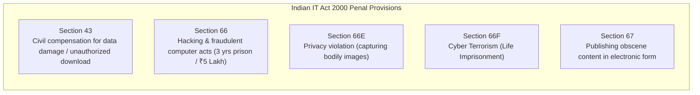

# Cyber Security & Laws (CS&L)
## Master Unified Question Bank & High-Yield Priority Guide
**Academic Context:** Mumbai University | B.E. / T.E. Information Technology | Semester VII (R-19 C-Scheme)  
**Subject Code:** 42686 / 42384 / 41984  
**Curated Sources:**
1. **MUSA (Mumbai University Students Association) Question Bank & Top 15 (Winter Session 2026)**
2. **Mumbai University 5-Paper PYQ Archive (2022 – 2025: Jun 25, Nov 24, Jan 24, Jun 23, Dec 22)**

---

## Table of Contents
1. [Master Priority Matrix (Ranked by Recurrence & MUSA Weight)](#1-master-priority-matrix)
2. [Tier 1: Ultra High Frequency (Repeated in 5 out of 5 Papers - 100% Recurrence)](#2-tier-1-ultra-high-frequency-55-papers)
3. [Tier 2: Very High Frequency (Repeated in 4 out of 5 Papers - 80% Recurrence)](#3-tier-2-very-high-frequency-45-papers)
4. [Tier 3: High Frequency (Repeated in 3 out of 5 Papers - 60% Recurrence)](#4-tier-3-high-frequency-35-papers)
5. [Tier 4: Moderate Frequency (Repeated in 2 out of 5 Papers - 40% Recurrence)](#5-tier-4-moderate-frequency-25-papers)
6. [MUSA Mandatory Section: Tabular Differentiations](#6-musa-mandatory-section-tabular-differentiations)
7. [MUSA Mandatory Section: High-Yield Short Notes](#7-musa-mandatory-section-high-yield-short-notes)
8. [Statutory Laws, Sections & Technical Attack Blueprints](#8-statutory-laws-sections--technical-attack-blueprints)
9. [High-Scoring 80-Mark Exam Strategy](#9-high-scoring-80-mark-exam-strategy)

---

## 1. Master Priority Matrix

| Rank | Topic / Question Description | PYQ Frequency | MUSA QB Ref | MUSA Top 15 Ref | Typical Marks | Priority Status |
| :---: | :--- | :---: | :---: | :---: | :---: | :--- |
| **01** | Buffer Overflow Attack Mechanisms & Mitigation (ASLR, Canaries) | **5 / 5 Papers (100%)** | Q.5 | **Top 15 #5** | 10M / 5M | `CRITICAL [Must Solve]` |
| **02** | HIPAA & SOX Regulatory Compliance & IT Requirements | **5 / 5 Papers (100%)** | Q.18 | **Top 15 #12** | 10M / 5M | `CRITICAL [Must Solve]` |
| **03** | E-Contracts: Types (Click/Shrink/Browse Wrap) & Legal Status | **5 / 5 Papers (100%)** | Q.15 | **Top 15 #11** | 10M / 5M | `CRITICAL [Must Solve]` |
| **04** | Classification of Cybercrimes & Cybercriminal Profiles | **5 / 5 Papers (100%)** | Q.2 | **Top 15 #2** | 10M / 5M | `CRITICAL [Must Solve]` |
| **05** | SQL Injection (SQLi) Steps, Bypass & Countermeasures | **4 / 5 Papers (80%)** | Q.4 | **Top 15 #4** | 10M | `CRITICAL [Must Solve]` |
| **06** | Digital Evidence: Definition, Rules, Admissibility & Evidence Bag | **4 / 5 Papers (80%)** | Q.11 | **Top 15 #8** | 10M / 5M | `CRITICAL [Must Solve]` |
| **07** | Planning of Cyberattacks by Criminals (Attack Lifecycle Phases) | **4 / 5 Papers (80%)** | Q.3 | **Top 15 #3** | 10M / 5M | `CRITICAL [Must Solve]` |
| **08** | DoS & DDoS Attack Mechanisms, Amplification & Defense | **4 / 5 Papers (80%)** | Q.6 | **Top 15 #6** | 10M / 5M | `CRITICAL [Must Solve]` |
| **09** | Organizational Security Risks & Business Data Challenges | **4 / 5 Papers (80%)** | Q.22 | Master QB | 5M | `VERY HIGH [Compulsory Q.1]`|
| **10** | Cyber Cafe Security Issues & Safety Precautions | **3 / 5 Papers (60%)** | Q.9 | **Top 15 #14** | 10M | `VERY HIGH [Syllabus Mod 2]`|
| **11** | Safeguarding Laptops and Mobile / Wireless Devices | **3 / 5 Papers (60%)** | Q.10 & Q.21 | **Top 15 #15** | 10M / 5M | `VERY HIGH [Syllabus Mod 2]`|
| **12** | Vishing (Voice Phishing) Attack Lifecycle & Defense | **3 / 5 Papers (60%)** | Q.8 | Short Note (v) | 5M / 10M | `VERY HIGH [Social Eng]` |
| **13** | IT Act 2000: Objectives, Features & Key Sections (43, 66, 67) | **3 / 5 Papers (60%)** | Q.13 & Q.14 | **Top 15 #10** | 10M / 5M | `VERY HIGH [Core Law]` |
| **14** | Botnets: Architecture, C&C Channels & Exploitation | **3 / 5 Papers (60%)** | Q.7 | **Top 15 #7** | 10M / 5M | `VERY HIGH [Network Threat]`|
| **15** | WIPO Treaties & Intellectual Property Rights (IPR) in Cyberspace | **3 / 5 Papers (60%)** | Q.16 | **Top 15 #13** | 10M | `VERY HIGH [Cyber Law]` |
| **16** | CIA Triad (Confidentiality, Integrity, Availability) & AAA Model | **2 / 5 Papers (40%)** | Q.1 | **Top 15 #1** | 5M / 10M | `HIGH [Core Foundational]`|
| **17** | Digital Forensics Investigation Stages (Lifecycle Phases) | **2 / 5 Papers (40%)** | Q.12 | **Top 15 #9** | 10M | `HIGH [Forensics Core]` |
| **18** | Electronic Banking Laws & Financial Cyber Frauds in India | **2 / 5 Papers (40%)** | Q.17 | Master QB | 10M | `HIGH [Banking Cyber]` |
| **19** | ISO/IEC 27001 Security Management Standard & Clauses | **2 / 5 Papers (40%)** | Q.19 | Master QB | 10M / 5M | `HIGH [Compliance/ISMS]` |
| **20** | Password Cracking Techniques & Corporate Password Policies | **2 / 5 Papers (40%)** | Q.20 | Master QB | 5M / 10M | `HIGH [Access Control]` |
| **21** | Active vs Passive Attacks & Threat Actors | **2 / 5 Papers (40%)** | Q.23 | Diff (iv) | 5M | `HIGH [Compulsory Q.1]` |

---

## 2. Tier 1: Ultra High Frequency (5/5 Papers - 100% Recurrence)

### [CSL-01] Buffer Overflow Attack Mechanisms & Mitigation Strategies
- **Repetition Frequency:** **5 out of 5 Papers (100% Recurrence)**
- **Exam Appearances:** Jun 2025 (Q.6c), Nov 2024 (Q.6c), Jan 2024 (Q.3a), Jun 2023 (Q.6c), Dec 2022 (Q.3a)
- **MUSA Reference:** Question Bank **Q.5** and **Top 15 #5**
- **Typical Marks:** 10 Marks (and 5M in Short Notes)

#### Exact Question Formulations:
> "Explain different buffer overflow attacks. Also explain how to mitigate buffer overflow attack."

#### Examiner Expected Answers Checklist:
- **Stack Architecture Diagram:**
  - Local Buffer $\to$ Saved Frame Pointer (EBP) $\to$ **Saved Return Address (EIP)** $\to$ Function Arguments.
- **Attack Execution Sequence:**
  1. Vulnerable C library functions (`strcpy()`, `gets()`, `sprintf()`) fail to enforce memory boundary checks.
  2. Attacker supplies payload exceeding buffer capacity: `[Padding Bytes] + [Shellcode] + [Overwritten Return Address]`.
  3. When function returns, processor pops the forged return address into EIP, redirecting execution directly to attacker-controlled shellcode with host privileges.
- **Attack Types:**
  - *Stack-Based Overflow:* Corrupts call stack pointers.
  - *Heap-Based Overflow:* Corrupts dynamic heap allocation headers and function pointers.
- **4 Mandatory Mitigation Techniques (Must Explain All Four):**
  1. **Safe API Usage:** Replace unsafe functions with bounds-checked alternatives (`strncpy()`, `fgets()`, `snprintf()`).
  2. **Stack Canaries (Stack Cookies):** Compiler inserts random canary word before EIP; checks integrity before returning.
  3. **ASLR (Address Space Layout Randomization):** Randomizes memory offsets for stack, heap, and shared libraries at boot.
  4. **DEP / NX-Bit (Data Execution Prevention):** Hardware CPU flag marking stack and heap memory pages as strictly non-executable (`W^X` - Write XOR Execute).

---

### [CSL-02] Statutory Compliance: HIPAA & SOX Regulatory Requirements
- **Repetition Frequency:** **5 out of 5 Papers (100% Recurrence)**
- **Exam Appearances:** Jun 2025 (Q.6b), Nov 2024 (Q.6b), Jan 2024 (Q.6b), Jun 2023 (Q.6b), Dec 2022 (Q.6b)
- **MUSA Reference:** Question Bank **Q.18** and **Top 15 #12**
- **Typical Marks:** 10 Marks (and 5M in Short Notes)

#### Exact Question Formulations:
> "Write key IT requirements for SOX and HIPAA." / "Explain what is Information Security Standard and Explain HIPAA act in detail."

#### Examiner Expected Answers Checklist:
- **SOX (Sarbanes-Oxley Act of 2002):**
  - *Objective:* Protects investors from corporate accounting fraud and financial tampering.
  - *Section 302:* Corporate responsibility for financial report accuracy.
  - *Section 404:* Mandates internal controls on financial reporting and IT infrastructure generating financial ledgers.
  - *Key IT Requirements:* Strict identity & access management (IAM), separation of duties (SoD), immutable audit logging, disaster recovery, change management controls.
- **HIPAA (Health Insurance Portability and Accountability Act of 1996):**
  - *Objective:* Safeguarding electronic Protected Health Information (ePHI).
  - *HIPAA Privacy Rule:* Regulates use and disclosure of patient health records.
  - *HIPAA Security Rule (3 Safeguards - Mandatory to detail):*
    1. **Administrative Safeguards:** Security officer assignment, workforce training, incident response plan.
    2. **Physical Safeguards:** Facility access controls, workstation security, device media disposal.
    3. **Technical Safeguards:** AES-256 encryption at rest/transit, multi-factor authentication (MFA), automatic logoff, audit controls.

---

### [CSL-03] E-Contracts: Types, Formation & Legal Enforceability
- **Repetition Frequency:** **5 out of 5 Papers (100% Recurrence)**
- **Exam Appearances:** Jun 2025 (Q.1e), Nov 2024 (Q.1e), Jan 2024 (Q.5b), Jun 2023 (Q.1e), Dec 2022 (Q.5b)
- **MUSA Reference:** Question Bank **Q.15** and **Top 15 #11**
- **Typical Marks:** 10 Marks / 5 Marks

#### Exact Question Formulations:
> "Define E-Contract. Explain the different types of E-Contracts." / "Explain the requirements of legally valid E-Contract under Indian IT Act."

#### Examiner Expected Answers Checklist:
- **Definition:** An electronic contract modeled, specified, executed, and deployed via software/electronic agents over digital networks.
- **Three Core Types of E-Contracts (Mandatory Definitions):**
  1. **Click-Wrap Contracts:** User must actively click `"I Agree"` or `"Accept"` button to manifest explicit consent before downloading or proceeding (e.g., Software installation terms).
  2. **Shrink-Wrap Contracts:** Common in packaged retail software; agreement is accepted when user tears open the plastic shrink-wrap packaging or breaks the physical seal.
  3. **Browse-Wrap Contracts:** Terms and conditions are accessible via a hyperlink at the bottom of a website; user implicitly accepts terms merely by continuing to browse the website.
- **Legal Validity under IT Act 2000 (Section 10A):**
  - Section 10A explicitly recognizes the validity of contracts formed through electronic means and digital communication.
  - Requires: Offer, Acceptance, Lawful Consideration, Competent Parties, Free Consent, and Lawful Object.

---

### [CSL-04] Classification of Cybercrimes & Cybercriminal Profiles
- **Repetition Frequency:** **5 out of 5 Papers (100% Recurrence)**
- **Exam Appearances:** Jun 2025 (Q.2a), Nov 2024 (Q.2a), Jan 2024 (Q.2a), Jun 2023 (Q.2a), Dec 2022 (Q.2a)
- **MUSA Reference:** Question Bank **Q.2** and **Top 15 #2**
- **Typical Marks:** 10 Marks / 5 Marks

#### Exact Question Formulations:
> "How are cybercrimes classified? Explain any one in detail." / "Classify cyber criminals and explain their motivations."

#### Examiner Expected Answers Checklist:
- **Classification by Target Category:**
  1. **Against Individuals:** Cyber stalking, harassment, defamation, identity theft, unauthorized distribution of obscene material (Section 67).
  2. **Against Property:** Credit card frauds, intellectual property theft, unauthorized fund transfers, malware/ransomware extortion.
  3. **Against Organization / Government:** Cyber terrorism (Section 66F), unauthorized intrusion into critical infrastructure, corporate espionage, website defacement.
- **Classification of Cyber Criminals:**
  - *Script Kiddies:* Inexperienced individuals running pre-written exploit tools without understanding underlying mechanics.
  - *Hacktivists:* Politically or ideologically motivated actors (defacing government sites, leaking emails).
  - *Organized Cyber Syndicates:* Financially motivated cartels running ransomware-as-a-service (RaaS).
  - *Insider Threats:* Disgruntled or compromised employees with legitimate access privileges.
  - *Nation-State Actors:* Advanced Persistent Threat (APT) groups conducting cyber warfare.

---

## 3. Tier 2: Very High Frequency (4/5 Papers - 80% Recurrence)

### [CSL-05] SQL Injection (SQLi) Steps, Bypass & Countermeasures
- **Repetition Frequency:** **4 out of 5 Papers (80% Recurrence)**
- **Exam Appearances:** Jun 2025 (Q.4a), Nov 2024 (Q.4a), Jan 2024 (Q.4a), Jun 2023 (Q.4a)
- **MUSA Reference:** Question Bank **Q.4** and **Top 15 #4**
- **Typical Marks:** 10 Marks

#### Exact Question Formulation:
> "What is SQL Injection? Explain the steps of SQL Injection with an example. How to prevent SQL injection?"

#### Examiner Expected Answers Checklist:
- **Definition:** Code injection technique where malicious SQL statements are inserted into entry fields for execution by the database engine.
- **Authentication Bypass Example:**
  - Vulnerable backend query:
    ```sql
    SELECT * FROM users WHERE username = '$user' AND password = '$pwd';
    ```
  - Attacker inputs: `admin' --` or `' OR '1'='1`
  - Resulting executed query:
    ```sql
    SELECT * FROM users WHERE username = 'admin' --' AND password = '...';
    ```
  - The `--` comments out password verification, granting unauthorized administrative login.
- **Types of SQLi:** In-band (Error-based, Union-based), Inferential / Blind (Boolean-based, Time-based), Out-of-band.
- **Countermeasures:** Parameterized queries / Prepared statements (`PreparedStatement` in Java, PDO in PHP), Stored procedures, Input validation (whitelist filtering), Web Application Firewalls (WAF), Principle of Least Privilege for DB accounts.

---

### [CSL-06] Digital Evidence: Definition, Rules, Admissibility & Evidence Bag
- **Repetition Frequency:** **4 out of 5 Papers (80% Recurrence)**
- **Exam Appearances:** Jun 2025 (Q.5b), Nov 2024 (Q.5b), Jan 2024 (Q.5a), Dec 2022 (Q.5a)
- **MUSA Reference:** Question Bank **Q.11** and **Top 15 #8**
- **Typical Marks:** 10 Marks / 5 Marks

#### Examiner Expected Answers Checklist:
- **Definition:** Any information or data of probative value stored or transmitted in binary digital form.
- **5 Rules of Digital Evidence:** Admissible, Authentic, Complete, Reliable, Believable.
- **Admissibility under Indian Law:**
  - **Section 65B of Indian Evidence Act:** Mandates written electronic certificate to accompany electronic records for admissibility in court.
- **Evidence Bag / Packaging Protocol:** Anti-static Faraday bags for mobile phones (blocks radio signals/remote wipe), tamper-evident security tape, evidence label (case ID, date, seizing officer name).

---

### [CSL-07] Planning of Cyberattacks by Criminals (Attack Lifecycle Phases)
- **Repetition Frequency:** **4 out of 5 Papers (80% Recurrence)**
- **Exam Appearances:** Jun 2025 (Q.3a), Nov 2024 (Q.3a), Jan 2024 (Q.3b), Jun 2023 (Q.3a)
- **MUSA Reference:** Question Bank **Q.3** and **Top 15 #3**
- **Typical Marks:** 10 Marks / 5 Marks

#### Examiner Expected Answers Checklist:
1. **Reconnaissance (Footprinting):** Active vs Passive information gathering (WHOIS, DNS, LinkedIn, social engineering).
2. **Scanning & Enumeration:** Port scanning (Nmap), vulnerability probing, service version detection.
3. **Gaining Access (Exploitation):** Exploiting web/OS vulnerabilities, buffer overflows, phishing payloads.
4. **Maintaining Access:** Installing backdoors, rootkits, creating rogue admin accounts.
5. **Covering Tracks:** Deleting system log files (`eventvwr`, `/var/log`), modifying timestamps, tunneling through proxies.

---

### [CSL-08] Denial of Service (DoS) & Distributed DoS (DDoS) Attacks
- **Repetition Frequency:** **4 out of 5 Papers (80% Recurrence)**
- **Exam Appearances:** Jun 2025 (Q.4b), Nov 2024 (Q.4b), Jan 2024 (Q.4b), Dec 2022 (Q.4b)
- **MUSA Reference:** Question Bank **Q.6** and **Top 15 #6**
- **Typical Marks:** 10 Marks / 5 Marks

#### Examiner Expected Answers Checklist:
- **Difference:** DoS uses a single system/IP to overwhelm target; DDoS utilizes thousands of geographically distributed compromised zombie nodes (Botnet).
- **Attack Types:**
  - *Network Volume Attacks:* UDP Flood, ICMP Ping of Death, NTP Amplification (spoofed IP requests large response).
  - *Protocol Attacks:* SYN Flood (abusing TCP 3-way handshake by leaving half-open connections).
  - *Application Layer Attacks:* HTTP Flood, Slowloris (opening slow connections and sending incomplete headers).
- **Mitigation:** Anycast routing, Rate limiting, Cloud scrubbing centers (Cloudflare, Akamai), Syn-cookies.

---

## 4. Tier 3: High Frequency (3/5 Papers - 60% Recurrence)

- **[CSL-09] Cyber Cafe Security Issues & Safety Precautions (MUSA QB Q.9 - 10M):**
  - Risks: Keyloggers installed on public terminals, session hijacking, unpatched OS, untrusted Wi-Fi.
  - Precautions: Mandatory photo ID register, CCTV surveillance, browser session wiping (Deep Freeze software), USB port disablement.
- **[CSL-10] Safeguarding Laptops & Mobile Wireless Devices (MUSA QB Q.10 & Q.21 - 10M):**
  - Physical locks (Kensington lock), Full disk encryption (BitLocker), Remote wipe capability (MDM), Disabling auto-connect to public open Wi-Fi networks.
- **[CSL-11] Vishing (Voice Phishing) Attack Lifecycle & Defense (MUSA QB Q.8 - 5M/10M):**
  - Social engineering attack conducted over telephone networks (VoIP spoofing); attacker poses as bank official requesting OTPs; defense includes zero-trust verification and user awareness.
- **[CSL-12] IT Act 2000 Objectives, Features & Key Sections (MUSA QB Q.13 & Q.14 - 10M):**
  - Facilitates electronic governance and e-commerce; provides legal recognition to digital signatures.
  - **Section 43:** Penalty for damage to computer systems (up to ₹1 Crore).
  - **Section 66:** Computer-related offenses (Hacking, fraud).
  - **Section 66E / 66F:** Violation of bodily privacy / Cyber terrorism.
  - **Section 67:** Publishing obscene material.
- **[CSL-13] Botnet Architecture & Command & Control (C&C) (MUSA QB Q.7 - 10M):**
  - Centralized (IRC / HTTP) vs Peer-to-Peer (P2P) botnet architectures; Lifecycle: Infection $\to$ Secondary injection $\to$ Connection $\to$ Malicious command execution $\to$ Update.
- **[CSL-14] Intellectual Property Rights (IPR) & WIPO Treaties (MUSA QB Q.16 - 10M):**
  - Copyright, Patents, Trademarks, Trade Secrets in digital domain; WIPO Copyright Treaty (WCT) and WIPO Performances and Phonograms Treaty (WPPT) protecting digital creations.

---

## 5. Tier 4: Moderate Frequency (2/5 Papers - 40% Recurrence)

- **[CSL-15] CIA Triad & AAA Security Framework (MUSA QB Q.1 - 5M/10M):**
  - Confidentiality (encryption), Integrity (hashes), Availability (redundancy/DDoS protection); Authentication, Authorization, Accounting.
- **[CSL-16] Digital Forensics Investigation Stages (MUSA QB Q.12 - 10M):**
  - 1. Identification $\to$ 2. Preservation (Bit-stream copy/imaging) $\to$ 3. Analysis $\to$ 4. Documentation & Reporting.
- **[CSL-17] Electronic Banking Laws & Frauds (MUSA QB Q.17 - 10M):**
  - ATM skimming, SIM swap fraud, phishing; RBI guidelines on unauthorized electronic banking transactions and consumer liability limits.
- **[CSL-18] ISO/IEC 27001 Security Standard (MUSA QB Q.19 - 10M):**
  - Information Security Management System (ISMS); Plan-Do-Check-Act (PDCA) cycle; Annex A control objectives.

---

## 6. MUSA Mandatory Section: Tabular Differentiations

### 1. Cyber Crimes vs Conventional (Terrestrial) Crimes
| Parameter / Basis | Conventional (Terrestrial) Crime | Cyber Crime |
| :--- | :--- | :--- |
| **Jurisdiction** | Confined to clear geographic boundaries | Boundaryless / Borderless across global jurisdictions |
| **Evidence Nature** | Physical (fingerprints, weapons, blood) | Intangible, volatile digital bits, logs, packets |
| **Speed & Scale** | Limited to immediate physical vicinity | Millions of victims targeted simultaneously in seconds |
| **Investigation** | Physical search warrants and forensics | Cross-border mutual legal assistance (MLAT), ISP subpoenas |

### 2. Virus vs Worm vs Trojan Horse
| Parameter / Basis | Computer Virus | Computer Worm | Trojan Horse |
| :--- | :--- | :--- | :--- |
| **Host File Needed?** | Yes, attaches to host executable (`.exe`) | No, standalone independent program | Yes, disguised as legitimate software |
| **Self-Replication** | Yes, replicates when host program runs | Yes, autonomously spreads across networks | No self-replication |
| **Propagation Vector**| File sharing, infected media, downloads | Exploits network vulnerabilities | Social engineering deception |

### 3. Symmetric vs Asymmetric Encryption
| Parameter / Basis | Symmetric Encryption | Asymmetric (Public Key) Encryption |
| :--- | :--- | :--- |
| **Keys Used** | Single shared secret key for encryption & decryption | Key pair: Public key (encrypt) & Private key (decrypt)|
| **Speed & Overhead**| Extremely fast; low computational overhead | Slower (100–1000x); heavy modular arithmetic |
| **Key Distribution**| High risk: securely exchanging secret key | Secure: Public key can be openly published |
| **Algorithms** | AES, DES, 3DES, Blowfish | RSA, ECC, Diffie-Hellman |

### 4. Active vs Passive Attacks
| Parameter / Basis | Passive Attack | Active Attack |
| :--- | :--- | :--- |
| **Data Modification**| No modification; strictly eavesdropping | Modifies data stream, alters packets, injects code |
| **System Impact** | Zero disruption to normal service | Severe disruption, crash, denial of service |
| **Detection** | Difficult to detect; focus on **Prevention** (Encryption)| Easy to detect; focus on **Detection & Recovery** |
| **Examples** | Packet sniffing, traffic analysis | MitM, SQL injection, DoS, session hijacking |

---

## 7. MUSA Mandatory Section: High-Yield Short Notes

1. **Steganography (MUSA Short Note i):**
   - Hiding secret messages within ordinary cover media (images, audio) so presence of communication is concealed; LSB (Least Significant Bit) insertion.
2. **Digital Signature & PKI (MUSA Short Note ii):**
   - Mathematical scheme using sender's private key to encrypt hash of message; provides Authenticity, Integrity, and Non-Repudiation.
3. **Chain of Custody (MUSA Short Note iii):**
   - Chronological paper trail documenting every individual who seized, transferred, analyzed, and stored digital evidence to prevent courtroom tampering challenges.
4. **Firewall vs IDS/IPS (MUSA Short Note iv):**
   - Firewall filters traffic based on port/IP rules; IDS passively detects signatures of attacks; IPS actively drops malicious packets inline.
5. **Vishing (MUSA Short Note v):**
   - Voice-based phishing abusing caller-ID spoofing to extract PINs, passwords, and 2FA tokens.

---

## 8. Statutory Laws, Sections & Technical Attack Blueprints



---

## 9. High-Scoring 80-Mark Exam Strategy

1. **Target Technical Attack Questions First (Q.2 to Q.6):**
   - Choose questions featuring **Buffer Overflow** and **SQL Injection**. Drawing the stack frame or query bypass example guarantees full marks.
2. **Include Statutory Sections for Cyber Law Questions:**
   - Whenever writing answers on cybercrime or compliance, explicitly cite **Section 43, 66, 67 of IT Act 2000** and **HIPAA Security Rule Safeguards** to elevate your score.
3. **Defend Question 1 (20 Marks Compulsory):**
   - Master the 4 MUSA tabular comparisons (Section 6) and the organizational security challenges to effortlessly score 18–20 marks on Q.1.
