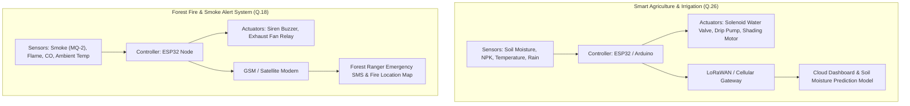

# Internet of Everything (IoE)
## Master Unified Question Bank & High-Yield Priority Guide
**Academic Context:** Mumbai University | B.E. / T.E. Information Technology | Semester VII (R-19 C-Scheme)  
**Subject Code:** 42672  
**Curated Sources:**
1. **MUSA (Mumbai University Students Association) Question Bank & Top 15 (Winter Session 2026)**
2. **Mumbai University 6-Paper PYQ Archive (2023 – 2025: Jun 25, Nov 24, Nov 25, Jun 24, Dec 23, Jun 23)**

---

## Table of Contents
1. [Master Priority Matrix (Ranked by Recurrence & MUSA Weight)](#1-master-priority-matrix)
2. [Tier 1: Ultra High Frequency (Repeated in 6 & 5 Papers - 100% & 83%)](#2-tier-1-ultra-high-frequency-6x--5x)
3. [Tier 2: Very High Frequency (Repeated in 4 Papers - 67%)](#3-tier-2-very-high-frequency-4x)
4. [Tier 3: High Frequency (Repeated in 3 Papers - 50%)](#4-tier-3-high-frequency-3x)
5. [Tier 4: Moderate Frequency (Repeated in 2 Papers - 33%)](#5-tier-4-moderate-frequency-2x)
6. [MUSA Mandatory Section: Tabular Differentiations (Q.24)](#6-musa-mandatory-section-tabular-differentiations)
7. [MUSA Mandatory Section: High-Yield Short Notes (Q.25)](#7-musa-mandatory-section-high-yield-short-notes)
8. [MUSA Mandatory Case Studies: End-to-End IoT Deployments (Q.18 & Q.26)](#8-musa-mandatory-case-studies-end-to-end-iot-deployments)
9. [High-Scoring 80-Mark Exam Strategy](#9-high-scoring-80-mark-exam-strategy)

---

## 1. Master Priority Matrix

| Rank | Topic / Question Description | PYQ Frequency | MUSA QB Ref | MUSA Top 15 Ref | Typical Marks | Priority Status |
| :---: | :--- | :---: | :---: | :---: | :---: | :--- |
| **01** | MQTT Architecture, Broker, Topics Hierarchy & QoS Handshakes | **6 / 6 Papers (100%)** | Q.2 | **Top 15 #2** | 10M | `CRITICAL [Must Solve]` |
| **02** | Edge, Fog & Cloud Computing Hierarchy & Comparison | **5 / 6 Papers (83%)** | Q.11 | **Top 15 #9** | 10M / 5M | `CRITICAL [Must Solve]` |
| **03** | CoAP Architecture, Message Types (CON/NON/ACK/RST) & REST | **5 / 6 Papers (83%)** | Q.5 | **Top 15 #5** | 10M / 5M | `CRITICAL [Must Solve]` |
| **04** | IoT Data Visualization Methods & Real-Time Dashboards | **5 / 6 Papers (83%)** | Q.13 | **Top 15 #12** | 10M | `CRITICAL [Must Solve]` |
| **05** | LoRa & LoRaWAN Architecture, End Devices (Class A/B/C) & Range | **4 / 6 Papers (67%)** | Q.6 | **Top 15 #8** | 10M | `VERY HIGH [Guaranteed]` |
| **06** | Smart Objects: Hardware Anatomy, Sensors, Actuators & Attributes | **4 / 6 Papers (67%)** | Q.7 | **Top 15 #4** | 10M / 5M | `VERY HIGH [Guaranteed]` |
| **07** | AMQP Architecture: Producers, Exchanges, Queues & Consumers | **4 / 6 Papers (67%)** | Q.15 | **Top 15 #11** | 10M / 5M | `VERY HIGH [Guaranteed]` |
| **08** | Internet of Behaviour (IoB) Definition, Architecture & Ethics | **4 / 6 Papers (67%)** | Q.22(i) | **Top 15 #14** | 5M / 10M | `VERY HIGH [Modern IoE]`|
| **09** | RFID Architecture: Tags (Active/Passive), Readers & Frequencies | **4 / 6 Papers (67%)** | Q.14 | Diff (i) | 10M / 5M | `VERY HIGH [Hardware]` |
| **10** | IoT Data Analytics vs Network Analytics Importance | **4 / 6 Papers (67%)** | Q.17 | Diff (ii) | 5M | `VERY HIGH [Analytics]` |
| **11** | NoSQL Databases in IoT Data Analytics Challenges (Big Data) | **3 / 6 Papers (50%)** | Q.3 | **Top 15 #3** | 10M | `HIGH [Core Module 4]` |
| **12** | Simplified 3-Layered IoT Architecture (Perception/Net/App) | **3 / 6 Papers (50%)** | Q.1 | **Top 15 #1** | 10M | `HIGH [Core Foundational]`|
| **13** | System Design Case Study: Smart Home & Smart Parking | **3 / 6 Papers (50%)** | Q.12 | **Top 15 #10** | 10M | `HIGH [System Design]` |
| **14** | System Design Case Study: Forest Fire & Smoke Detection | **3 / 6 Papers (50%)** | Q.18 & Q.26 | Top 15 Q.16 Note | 10M | `HIGH [System Design]` |
| **15** | Functional Blocks of IoT Architecture (6 Core Blocks) | **3 / 6 Papers (50%)** | Q.16 & Q.19 | **Top 15 #13** | 10M / 5M | `HIGH [Architecture]` |
| **16** | ZigBee (IEEE 802.15.4): Topologies (Star/Tree/Mesh) & Device Roles| **3 / 6 Papers (50%)** | Q.9 | Master QB | 10M / 5M | `HIGH [Wireless Stack]` |
| **17** | IoT World Forum (IoTWF) 7-Layer Reference Model | **2 / 6 Papers (33%)** | Q.4 | **Top 15 #6** | 10M | `MODERATE [Standards]` |
| **18** | IEEE 802.11 Wi-Fi Architecture: BSS, ESS, AP & Distribution Sys | **2 / 6 Papers (33%)** | Q.8 | **Top 15 #7** | 10M | `MODERATE [Wireless LAN]`|
| **19** | Wireless Access Technologies: IEEE 802.15.4, LTE-A, 6LoWPAN | **2 / 6 Papers (33%)** | Q.23 | **Top 15 #15** | 10M / 5M | `MODERATE [Access Tech]` |
| **20** | Protocol Comparison: HTTP vs WebSocket vs MQTT | **2 / 6 Papers (33%)** | Q.20 | Master QB | 10M | `MODERATE [Protocols]` |
| **21** | Data Storage: Data Lakes vs Data Swamps & Retention Strategy | **2 / 6 Papers (33%)** | Q.21 & Q.25(ii)| Short Note (ii) | 10M / 5M | `MODERATE [Data Eng]` |
| **22** | Near Field Communication (NFC) Modes of Operation | **2 / 6 Papers (33%)** | Q.25(iii) | Short Note (iii)| 5M | `MODERATE [Compulsory Q.1]`|
| **23** | Bluetooth Low Energy (BLE) Protocol Stack & GATT Profile | **2 / 6 Papers (33%)** | Q.25(iv) | Short Note (iv) | 5M | `MODERATE [Compulsory Q.1]`|
| **24** | Physical Design vs Logical Design of IoT Systems | **2 / 6 Papers (33%)** | Q.24(iii) | Diff (iii) | 5M | `MODERATE [Compulsory Q.1]`|
| **25** | System Design Case Study: Smart Farming & Smart Irrigation | *MUSA Core* | Q.26 | Top 15 Q.16 Note | 10M | `NEW [High-Yield Case]`|
| **26** | STOMP & IIoT (Industrial IoT) in Smart Factories | *MUSA Core* | Q.22(ii,iii) | **Top 15 #14** | 5M | `NEW [Industrial IoE]` |

---

## 2. Tier 1: Ultra High Frequency (6x & 5x)

### [IOE-01] MQTT (Message Queuing Telemetry Transport) Architecture & Working
- **Repetition Frequency:** **6 out of 6 Papers (100% Recurrence)**
- **Exam Appearances:** Jun 2025 (Q.3a), Nov 2024 (Q.4b), Nov 2025 (Q.4b), Jun 2024 (Q.5a), Dec 2023 (Q.5a), Jun 2023 (Q.6a)
- **MUSA Reference:** Question Bank **Q.2** and **Top 15 #2**
- **Typical Marks:** 10 Marks

#### Examiner Expected Answers Checklist:
- **Architectural Diagram:**
  $$\text{Publisher (Sensors)} \xrightarrow[\text{Topic: home/temp}]{\text{PUBLISH}} \mathbf{MQTT\ Broker} \xrightarrow[\text{Subscribed: home/+}]{\text{DISPATCH}} \text{Subscribers (Apps / Cloud)}$$
- **Core Components:**
  1. *Publishers:* Constrained sensor nodes generating data.
  2. *Central Broker:* Stateful server managing topic trees, authenticating clients, filtering and dispatching payloads.
  3. *Subscribers:* Client devices registering interest in specific topics.
- **Three Quality of Service (QoS) Levels (Mandatory Detailed Diagrams):**
  - **QoS 0 (At most once):** Best-effort delivery. No acknowledgement or retransmission. Packet loss acceptable.
  - **QoS 1 (At least once):** Guaranteed delivery. Sender transmits `PUBLISH` and waits for `PUBACK`. Can produce duplicates.
  - **QoS 2 (Exactly once):** Guaranteed delivery with zero duplication via 4-way handshake:
    $$\text{Client} \xrightarrow{\text{PUBLISH}} \text{Broker} \xrightarrow{\text{PUBREC}} \text{Client} \xrightarrow{\text{PUBREL}} \text{Broker} \xrightarrow{\text{PUBCOMP}} \text{Client}$$
- **Special Features:** Retained Messages, Last Will and Testament (LWT), Topic wildcards (`+` single level, `#` multi-level recursive).

---

### [IOE-02] Edge, Fog & Cloud Computing Hierarchy & Comparative Analysis
- **Repetition Frequency:** **5 out of 6 Papers (83% Recurrence)**
- **Exam Appearances:** Nov 2024 (Q.1d), Nov 2025 (Q.1b), Jun 2024 (Q.4a), Dec 2023 (Q.4a), Jun 2023 (Q.2a)
- **MUSA Reference:** Question Bank **Q.11** and **Top 15 #9**
- **Typical Marks:** 10 Marks / 5 Marks

#### 3-Tier Hierarchy Diagram:
$$\text{Level 1: Edge (On-Device/Microcontrollers) } [\le 10\text{ms latency}] \longrightarrow \text{Level 2: Fog (Gateways/Local Servers) } [\approx 50\text{ms}] \longrightarrow \text{Level 3: Cloud (Data Centers) } [>200\text{ms}]$$

#### Comparative Matrix:
| Parameter / Basis | Edge Computing | Fog Computing | Cloud Computing |
| :--- | :--- | :--- | :--- |
| **Location** | On physical sensor nodes/actuators | Intermediate local gateways, routers | Centralized global data centers |
| **Latency** | Ultra-low (sub-millisecond) | Moderate (tens of milliseconds) | High (hundreds of milliseconds) |
| **Bandwidth Usage**| Negligible; data processed locally | Low; aggregated data transmitted | High; raw streams sent over WAN |
| **Storage & Compute**| Severely constrained (KB to MB) | Moderate (GB) | Virtually limitless (TB to PB) |
| **Best Used For** | Immediate emergency shutdown, ABS | Local traffic coordination, factory cells | Historical big data analytics, deep training |

---

### [IOE-03] CoAP (Constrained Application Protocol) Architecture & Message Model
- **Repetition Frequency:** **5 out of 6 Papers (83% Recurrence)**
- **Exam Appearances:** Jun 2025 (Q.2a), Nov 2024 (Q.2a), Jun 2024 (Q.2a), Dec 2023 (Q.2a), Jun 2023 (Q.1e)
- **MUSA Reference:** Question Bank **Q.5** and **Top 15 #5**
- **Typical Marks:** 10 Marks / 5 Marks

#### Examiner Expected Answers Checklist:
- **Design Objective:** Specialized web transfer protocol for constrained nodes and networks (RFC 7252); lightweight REST over **UDP** instead of TCP.
- **2-Layer Architecture:**
  - *Messages Layer:* Deals with UDP communication and packet reliability.
  - *Request/Response Layer:* Deals with REST methods (`GET`, `POST`, `PUT`, `DELETE`).
- **4 Message Types:**
  1. **Confirmable (CON):** Requires reliable transport; receiver must return an `ACK` matching Message ID.
  2. **Non-Confirmable (NON):** Unreliable sensor telemetry; no acknowledgment required.
  3. **Acknowledgement (ACK):** Returned to confirm arrival of a `CON` packet; can piggyback data payload.
  4. **Reset (RST):** Sent when a packet is received that cannot be processed.
- **Resource Observation:** Asynchronous publish/subscribe extension (`GET` with `Observe` flag) eliminating polling.

---

### [IOE-04] IoT Data Visualization Methods & Real-Time Dashboards
- **Repetition Frequency:** **5 out of 6 Papers (83% Recurrence)**
- **Exam Appearances:** Jun 2025 (Q.5b), Nov 2024 (Q.5b), Nov 2025 (Q.5b), Jun 2024 (Q.6a), Dec 2023 (Q.6b)
- **MUSA Reference:** Question Bank **Q.13** and **Top 15 #12**
- **Typical Marks:** 10 Marks

#### Examiner Expected Answers Checklist:
- **Core Purpose:** Transforming high-velocity raw time-series telemetry streams into actionable human cognitive representations.
- **Visualization Techniques (Must Explain & Draw 5):**
  1. *Real-Time Gauge Charts:* Immediate visualization of threshold bounds (e.g., boiler pressure, CPU temperature).
  2. *Time-Series Line Graphs:* Historical trends and drift patterns over hours/days (soil moisture, battery discharge).
  3. *Heat Maps:* Spatial sensor density across geographical regions (smart parking occupancy, forest fire risk zones).
  4. *Scatter Plots & Anomaly Outliers:* Identifying sensor drift, faulty readings, and correlation between variables.
  5. *Geographical GIS Maps:* Fleet management tracking, vehicle location overlays.
- **Dashboard Architecture:** WebSockets / Server-Sent Events (SSE) data feeding frontend charting libraries (Grafana, D3.js).

---

## 3. Tier 2: Very High Frequency (4x)

- **[IOE-05] LoRa & LoRaWAN Architecture (MUSA QB Q.6 & Top 15 #8 - 10M):**
  - Chirp Spread Spectrum (CSS) modulation; Star-of-Stars network topology.
  - Architecture: End Nodes $\xrightarrow{\text{RF LoRa}}$ Gateways (Concentrators) $\xrightarrow{\text{IP Backhaul}}$ Network Server $\xrightarrow{\text{SSL}}$ Application Server.
  - Device Classes: Class A (Lowest power, bidirectional after uplink), Class B (Beacon synchronized downlink slots), Class C (Continuous listening, mains powered).
- **[IOE-06] Smart Objects Anatomy & Attributes (MUSA QB Q.7 & Top 15 #4 - 10M/5M):**
  - Definition: Physical unit augmented with computing and network connectivity.
  - Components: Sensors (Physical $\to$ Electrical), Microcontroller/Processor, Memory (SRAM/Flash), Communication Transceiver, Actuators, Power Source (Battery/Energy harvesting).
  - Characteristics: Context-awareness, Autonomous behavior, Unique identification (IPv6/MAC).
- **[IOE-07] AMQP Architecture & Components (MUSA QB Q.15 & Top 15 #11 - 10M):**
  - Enterprise asynchronous protocol; Producers publish messages with Routing Keys $\to$ **Exchanges** (Direct, Fanout, Topic, Headers) $\xrightarrow[\text{Binding Keys}]{\text{Filter}}$ Message Queues $\to$ Consumers.
- **[IOE-08] Internet of Behaviour (IoB) (MUSA QB Q.22(i) & Top 15 #14 - 10M/5M):**
  - Convergence of IoT data collection + Big Data Analytics + Behavioral Science (psychology) to monitor, understand, and influence human decisions; Applications: Telematics insurance premiums, fitness incentives, workplace safety.

---

## 4. Tier 3: High Frequency (3x)

- **[IOE-09] NoSQL in IoT Big Data Analytics (MUSA QB Q.3 & Top 15 #3 - 10M):**
  - Why relational SQL fails: rigid schemas cannot handle heterogeneous sensors; write throughput bottleneck.
  - NoSQL Categories: Key-Value (Redis - latest device state), Document (MongoDB - complex sensor JSON payloads), Wide-Column (Cassandra - high-velocity time-series sensor ingestion), Graph (Neo4j - IoT device topologies).
- **[IOE-10] Simplified 3-Layered IoT Architecture (MUSA QB Q.1 & Top 15 #1 - 10M):**
  - Perception Layer (Sensors/Actuators) $\to$ Network Layer (Wi-Fi, 4G, Zigbee, Routing) $\to$ Application Layer (Smart Services, Dashboards).
- **[IOE-11] Functional Blocks of IoT Architecture (MUSA QB Q.16 & Top 15 #13 - 10M/5M):**
  - Device, Communication, Services, Management, Security, Application.

---

## 5. Tier 4: Moderate Frequency (2x)

- **[IOE-12] IoT World Forum (IoTWF) 7-Layer Reference Model (MUSA QB Q.4 & Top 15 #6 - 10M):**
  - Layer 1 (Physical Devices) $\to$ Layer 2 (Connectivity) $\to$ Layer 3 (Edge Computing) $\to$ Layer 4 (Data Accumulation) $\to$ Layer 5 (Data Abstraction) $\to$ Layer 6 (Application) $\to$ Layer 7 (Collaboration & Business Processes) + Cross-Layer Security.
- **[IOE-13] IEEE 802.11 Architecture (MUSA QB Q.8 & Top 15 #7 - 10M):**
  - Basic Service Set (BSS), Extended Service Set (ESS), Access Points (AP), Distribution System (DS), Portal to Internet.
- **[IOE-14] Protocol Comparison: HTTP vs WebSocket vs MQTT (MUSA QB Q.20 - 10M):**
  - Full 10-point comparison table covering transport, connection persistence, payload overhead, latency, and bidirectional capability.

---

## 6. MUSA Mandatory Section: Tabular Differentiations

### 1. RFID vs Bluetooth
| Parameter / Basis | RFID (Radio Frequency Identification) | Bluetooth (including BLE) |
| :--- | :--- | :--- |
| **Primary Purpose** | Automated object identification and tracking | Short-range personal wireless data exchange |
| **Power Source** | Passive tags require no battery (powered by reader RF)| Active battery required |
| **Communication** | One-way interrogator-tag telemetry | Full bidirectional communication channel |
| **Data Capacity** | Small (few bytes to kilobytes - UID) | High (megabytes of streaming sensor data) |
| **Pairing** | Zero pairing required; immediate scan | Requires device pairing and bond management |

### 2. IoT Data Analytics vs IoT Network Analytics
| Parameter / Basis | IoT Data Analytics | IoT Network Analytics |
| :--- | :--- | :--- |
| **Focus Area** | Payload information collected by sensors | Health and performance of communication links |
| **Metrics Tracked** | Temperature, vibration, energy usage, predictions | Packet loss, latency, jitter, throughput, SNR |
| **Target User** | Domain specialists, business analysts, data scientists| Network administrators, infrastructure engineers |
| **Action Taken** | Predictive maintenance, automated irrigation | Re-routing mesh paths, power adjustment, channel hop|

### 3. Physical Design vs Logical Design of IoT
| Parameter / Basis | Physical Design of IoT | Logical Design of IoT |
| :--- | :--- | :--- |
| **Core Nature** | Hardware components and physical wiring interfaces | Abstract functional organization, APIs, protocols |
| **Elements** | Sensors, Microcontrollers (ESP32), Actuators, Transceivers | Functional blocks, Communication models, REST APIs |
| **Representation**| Circuit schematics, hardware pinouts, wiring diagrams| Flowcharts, UML sequence diagrams, state machines |

---

## 7. MUSA Mandatory Section: High-Yield Short Notes

1. **Data Acquisition in IoT (Q.25(i)):**
   - Transducer sensing $\to$ Signal conditioning (amplification, low-pass filtering) $\to$ Analog-to-Digital Converter (ADC) $\to$ Edge buffer sampling.
2. **Data Retention Strategy (Q.25(ii)):**
   - Hot Storage (In-memory/SSD time-series for immediate dashboard alerts, 1-7 days) $\to$ Warm Storage (Aggregated daily summaries, 1-12 months) $\to$ Cold Storage (Data Lake/S3 Glacier deep archival for historical machine learning).
3. **Near Field Communication - NFC (Q.25(iii)):**
   - High-frequency RFID derivative (13.56 MHz, distance $< 4\text{ cm}$); 3 Operational Modes: Reader/Writer, Peer-to-Peer, Card Emulation (Apple/Google Pay).
4. **Bluetooth Low Energy - BLE (Q.25(iv)):**
   - 2.4 GHz ISM band; ultra-low sleep current; Generic Attribute Profile (GATT) hierarchy: Profile $\to$ Service $\to$ Characteristic $\to$ Descriptor.

---

## 8. MUSA Mandatory Case Studies: End-to-End IoT Deployments

---

## 9. High-Scoring 80-Mark Exam Strategy

1. **Always Draw the Complete Protocol Diagram:**
   - When writing on **MQTT**, draw the Publisher-Broker-Subscriber tree and the QoS 2 handshake. When writing on **CoAP**, draw the 4 packet types. This guarantees 9–10 marks per question.
2. **Include Complete Component Tables for Case Studies:**
   - In system design questions (Smart Home, Forest Fire, Irrigation), create a neat table specifying: **Sensors**, **Actuators**, **Microcontroller**, **Wireless Protocol**, and **Cloud Analytics Platform**.
3. **Master Section 6 Differentiations:**
   - The RFID vs Bluetooth, Data Analytics vs Network Analytics, and Physical vs Logical design comparisons appear frequently in Question 1.
