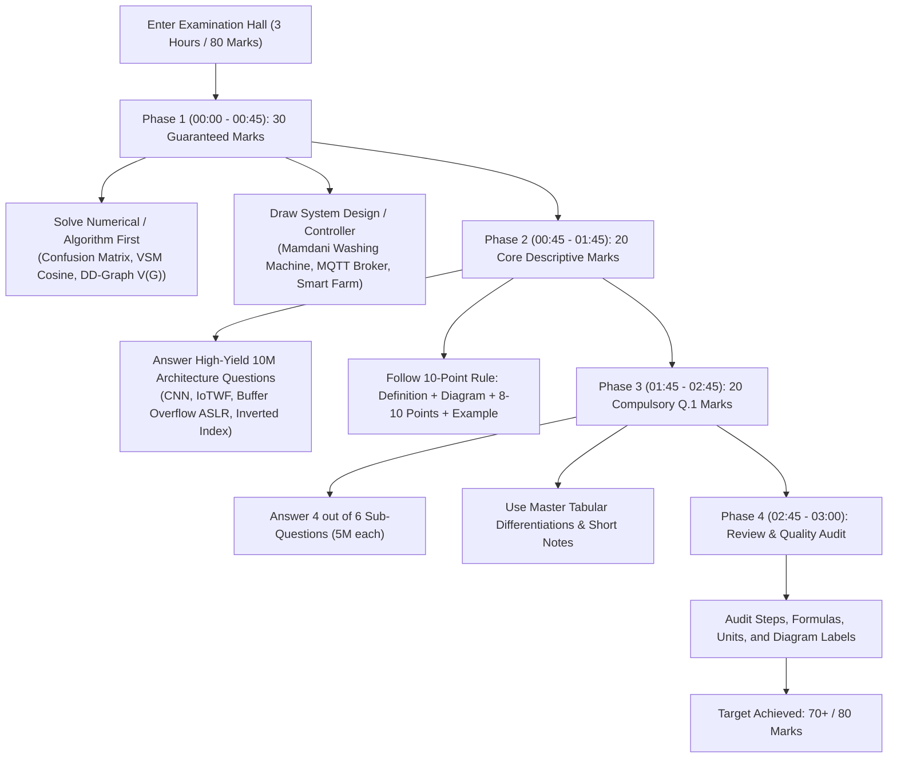

# IT SEM 7 NOTES - QUESTION BANK, PYQ & MUSA 2026 ARCHIVE


A comprehensive, curated examination revision archive for **B.E. / T.E. Information Technology Semester VII (Mumbai University, R-19 C-Scheme)**. 

This repository consolidates two authoritative study pillars:
1. **Verified Previous Year Question (PYQ) Papers (2022 – 2025)**: Full exam archives with 100% human-verified clean text transcriptions (`.txt`), stripped of red watermarks and background codes.
2. **MUSA (Mumbai University Students Association) Winter Session 2026 Edition**: Question Banks, prioritized "Top 15" core lists, and comprehensive model answer manuals with full architectural diagrams.
3. **Master Sorted Question Banks (`*_Master_Sorted_Question_Bank.md`)**: Complete subject guides ordered strictly by **historical repetition frequency** ($6\times \to 5\times \to 4\times \to 3\times \to 2\times \to 1\times$ + MUSA 2026 specials), featuring examiner-expected 10-point answer checklists, mandatory tabular differentiations, high-yield short notes, and step-by-step solved numericals.

**Maintainer:** Aaditya Gunjal - TE IT, Mumbai University

---

## Repository Structure

```text
IT7sem Notes/
├── README.md                                           # Master Repository Index & Study Guide
├── scripts/
│   ├── ocr_pdf_extractor.py                            # AI & OCR Watermark Stripping Pipeline
│   └── requirements.txt                                # Python Environment Dependencies
├── AI & DS II/
│   ├── AI&DS_Master_Sorted_Question_Bank.md            # 🔥 Master Guide (Ordered by Frequency + Solved Numericals)
│   ├── AI&DS MUSA QB & Solutions.pdf                   # MUSA Winter 2026 QB + Solutions (74 Pages)
│   ├── AI&DS PYQ.pdf                                   # Original University Question Papers (8 Pages)
│   ├── AI&DS PYQ.txt                                   # Human-Verified Text Transcription (6 Papers)
│   ├── AI&DS_Question_Bank.md                          # Formatted Module Breakdown & Blueprints
│   ├── AI&DS_Question_Bank_By_Frequency.txt            # Frequency Index (5M & 10M Split)
│   └── AI&DS_Repeated_Questions.txt                    # Detailed Repetition Analysis & Calculations
├── Cyber Security & Laws/
│   ├── CSL_Master_Sorted_Question_Bank.md              # 🔥 Master Guide (Ordered by Frequency + Attack Blueprints)
│   ├── CSL MUSA QB & Top 15.pdf                        # MUSA Winter 2026 QB + Top 15 (5 Pages)
│   ├── CS&L PYQ.pdf                                    # Original University Question Papers (5 Pages)
│   ├── CS&L PYQ.txt                                    # Human-Verified Text Transcription (5 Papers)
│   ├── CS&L_Question_Bank.md                           # Statutory Sections & Incident Checklists
│   ├── CS&L_Question_Bank_By_Frequency.txt             # Frequency Index (5M & 10M Split)
│   └── CS&L_Repeated_Questions.txt                     # Detailed Repetition Analysis & Legal Notes
├── Information Retrieval System/
│   ├── IRS_Master_Sorted_Question_Bank.md              # 🔥 Master Guide (Ordered by Frequency + VSM/Boyer-Moore)
│   ├── IRS MUSA QB.pdf                                 # MUSA Winter 2026 Question Bank (3 Pages)
│   ├── IRS PYQ.pdf                                     # Original University Question Papers (5 Pages)
│   ├── IRS PYQ.txt                                     # Human-Verified Text Transcription (5 Papers)
│   ├── IRS_Question_Bank.md                            # Preprocessing & Search Architecture Blueprints
│   ├── IRS_Question_Bank_By_Frequency.txt              # Frequency Index (5M & 10M Split)
│   └── IRS_Repeated_Questions.txt                      # Detailed Repetition Analysis & Math Traces
├── Internet Of Everything/
│   ├── IOE_Master_Sorted_Question_Bank.md              # 🔥 Master Guide (Ordered by Frequency + Protocol Blueprints)
│   ├── IOE MUSA QB & Solutions.pdf                     # MUSA Winter 2026 QB + Solutions (92 Pages)
│   ├── IOE PYQ.pdf                                     # Original University Question Papers (6 Pages)
│   ├── IOE PYQ.txt                                     # Human-Verified Text Transcription (6 Papers)
│   ├── IOE_Question_Bank.md                            # Edge/Fog/Cloud & End-to-End System Designs
│   ├── IOE_Question_Bank_By_Frequency.txt              # Frequency Index (5M & 10M Split)
│   └── IOE_Repeated_Questions.txt                      # Detailed Repetition Analysis & Topologies
└── Software Testing & QA/
    ├── STQA_Master_Sorted_Question_Bank.md             # 🔥 Master Guide (Ordered by Frequency + DD-Graphs)
    ├── STQA MUSA QB & Top 15.pdf                       # MUSA Winter 2026 QB + Top 15 (5 Pages)
    ├── STQA MUSA Solutions.pdf                         # MUSA Winter 2026 Complete Solution Manual (33 Pages)
    ├── Software Testing & QA PYQ.pdf                   # Original University Question Papers (3 Pages)
    ├── Software Testing & QA PYQ.txt                   # Human-Verified Text Transcription (2 Papers)
    ├── Software_Testing_QA_Question_Bank.md            # Black-Box & White-Box Testing Checklists
    ├── Software_Testing_QA_Question_Bank_By_Frequency.txt# Frequency Index (5M & 10M Split)
    └── Software_Testing_QA_Repeated_Questions.txt      # Detailed Repetition Analysis & V(G) Traces
```

---

## Subject Master Guides & Question Paper Inventories

### 1. [AI & DS II](./AI%20%26%20DS%20II/)
*   **🔥 Master Priority Guide:** **[`AI&DS_Master_Sorted_Question_Bank.md`](./AI%20%26%20DS%20II/AI&DS_Master_Sorted_Question_Bank.md)**  
    *Questions ordered by recurrence (6x down to 1x), full Confusion Matrix numerical walkthroughs, Mamdani controller, CNN/LSTM architectures, and Q.1 differentiations.*
*   **MUSA Winter 2026 Material:** **[`AI&DS MUSA QB & Solutions.pdf`](./AI%20%26%20DS%20II/AI&DS%20MUSA%20QB%20%26%20Solutions.pdf)** (74 Pages: Master QB, Top 15, and 10-point model answers).
*   **PYQ Transcriptions:** **[`AI&DS PYQ.txt`](./AI%20%26%20DS%20II/AI&DS%20PYQ.txt)** | **[`AI&DS PYQ.pdf`](./AI%20%26%20DS%20II/AI&DS%20PYQ.pdf)**
*   **Indexed Exam Papers (6 Papers):**
    1. DEC-2025 (QP Code: 84098) — *Bayes Medical Test, CNN, LSTM, Cognitive Principles, Multimodal ML*
    2. 02/06/2025 (QP Code: 10084099) — *McCulloch-Pitts AND, Taxonomies/Ontologies, BBN Inferencing, Bagging/Boosting*
    3. 12/11/2024 (QP Code: 10067845) — *Two Classifiers Evaluation Numerical, Ensemble Methods, Cognitive Systems*
    4. May / June 2024 (QP Code: 10056808) — *Card Probability Numerical, Fraud Detection Confusion Matrix, Autoencoders*
    5. 26/12/2023 (QP Code: 10038602) — *Buys_Computer 10,000 Sample Matrix, Cavity Probability, Defuzzification*
    6. 14/06/2023 (QP Code: 10027194) — *XOR McCulloch-Pitts 10M, Evaluation Metrics, Holdout Sampling*

---

### 2. [Cyber Security & Laws](./Cyber%20Security%20%26%20Laws/)
*   **🔥 Master Priority Guide:** **[`CSL_Master_Sorted_Question_Bank.md`](./Cyber%20Security%20%26%20Laws/CSL_Master_Sorted_Question_Bank.md)**  
    *100% recurrence topics (Buffer Overflow, HIPAA/SOX, E-Contracts, Cybercrime Classification), IT Act 2000 sections (43, 66, 67), and attack defense blueprints.*
*   **MUSA Winter 2026 Material:** **[`CSL MUSA QB & Top 15.pdf`](./Cyber%20Security%20%26%20Laws/CSL%20MUSA%20QB%20%26%20Top%2015.pdf)** (5 Pages: Master QB + Top 15).
*   **PYQ Transcriptions:** **[`CS&L PYQ.txt`](./Cyber%20Security%20%26%20Laws/CS%26L%20PYQ.txt)** | **[`CS&L PYQ.pdf`](./Cyber%20Security%20%26%20Laws/CS%26L%20PYQ.pdf)**
*   **Indexed Exam Papers (5 Papers):**
    1. 13/06/2025 (QP Code: 10055704) — *Mobile Vulnerabilities, WIPO Treaties, SQL Injection, E-contracts, Cyber Cafe Security*
    2. 25/11/2024 (QP Code: 10055703) — *Digital Evidence, Planning Cyberattacks, Vishing Attacks, Botnets, HIPAA*
    3. 03/01/2024 (QP Code: 10038595) — *Buffer Overflow Mitigation (ASLR/Canaries), E-banking Laws, DoS/DDoS, IT Act 2000, SOX*
    4. 26/06/2023 (QP Code: 10026426) — *Password Policies, Virus vs Worm, Steganography, Cyber Defamation*
    5. 19/12/2022 (QP Code: 10015878) — *Terrestrial vs Cybercrimes, Information Security Standards, Credit Card Frauds*

---

### 3. [Information Retrieval System](./Information%20Retrieval%20System/)
*   **🔥 Master Priority Guide:** **[`IRS_Master_Sorted_Question_Bank.md`](./Information%20Retrieval%20System/IRS_Master_Sorted_Question_Bank.md)**  
    *Inverted Index & Block Addressing, Rocchio Relevance Feedback, Vector Space Model $tf\text{-}idf$ cosine ranking numericals, MIR (VIR/IIR), and Boyer-Moore tables.*
*   **MUSA Winter 2026 Material:** **[`IRS MUSA QB.pdf`](./Information%20Retrieval%20System/IRS%20MUSA%20QB.pdf)** (3 Pages: Master Question Bank & Numericals).
*   **PYQ Transcriptions:** **[`IRS PYQ.txt`](./Information%20Retrieval%20System/IRS%20PYQ.txt)** | **[`IRS PYQ.pdf`](./Information%20Retrieval%20System/IRS%20PYQ.pdf)**
*   **Indexed Exam Papers (5 Papers):**
    1. 10/06/2025 (QP Code: 10082376) — *Vector Space Ranking, Boyer Moore Algorithm, Suffix Trees/Arrays, Result Visualization*
    2. 20/11/2025 (QP Code: 95849) — *Structured Text Retrieval, Meta Searchers, Mobile UX Visualization, Video & Image IR*
    3. 14/12/2024 (QP Code: 10065526) — *Vector Model Ranking, Huffman Trees, Inverted Index Construction, Probabilistic Models*
    4. 12/06/2024 (QP Code: 10056741) — *Search Engine Operations, Proximity vs Wildcard Queries, User Relevance Feedback*
    5. 22/06/2023 (QP Code: 10029885) — *Classic IR Models, Object Relational DBMS, Scalar & Metric Clusters*

---

### 4. [Internet Of Everything](./Internet%20Of%20Everything/)
*   **🔥 Master Priority Guide:** **[`IOE_Master_Sorted_Question_Bank.md`](./Internet%20Of%20Everything/IOE_Master_Sorted_Question_Bank.md)**  
    *MQTT (QoS 0/1/2 Handshakes), Edge/Fog/Cloud hierarchy, CoAP (CON/NON), LoRaWAN, Smart Objects, AMQP, and end-to-end case studies (Forest Fire, Smart Farming, Smart Irrigation).*
*   **MUSA Winter 2026 Material:** **[`IOE MUSA QB & Solutions.pdf`](./Internet%20Of%20Everything/IOE%20MUSA%20QB%20%26%20Solutions.pdf)** (92 Pages: Master QB, Top 15, and comprehensive model solutions).
*   **PYQ Transcriptions:** **[`IOE PYQ.txt`](./Internet%20Of%20Everything/IOE%20PYQ.txt)** | **[`IOE PYQ.pdf`](./Internet%20Of%20Everything/IOE%20PYQ.pdf)**
*   **Indexed Exam Papers (6 Papers):**
    1. 04/06/2025 (QP Code: 10083969) — *Smart Objects, AMQP Architecture, IoTWF 7-Layer, LoRaWAN, Forest Fire Detection*
    2. 14/11/2024 (QP Code: 10067160) — *Home Automation System, CoAP & Data Lakes, IEEE 802.11 Components*
    3. 14/11/2025 (QP Code: 95963) — *Smart Parking System, STOMP Protocol, 3-Layered IoT Architecture*
    4. 06/06/2024 (QP Code: 10054714) — *Healthcare IoT Dashboard, HTTP vs WebSocket vs MQTT, Edge vs Cloud*
    5. 28/12/2023 (QP Code: 10038114) — *ZigBee Topologies, Data Refineries & Data Swamps, Smart Irrigation System*
    6. 16/06/2023 (QP Code: 10026510) — *Internet of Behaviour (IoB), Smart Farming System, 6LoWPAN Access*

---

### 5. [Software Testing & QA](./Software%20Testing%20%26%20QA/)
*   **🔥 Master Priority Guide:** **[`STQA_Master_Sorted_Question_Bank.md`](./Software%20Testing%20%26%20QA/STQA_Master_Sorted_Question_Bank.md)**  
    *White-Box DD-Graphs & Cyclomatic Complexity $V(G)$, Agile ATLC, Mutation Testing Score, Selenium WebDriver, Boundary Value Analysis (BVA), and Defect Spoilage calculations.*
*   **MUSA Winter 2026 Material:**  
    *   **[`STQA MUSA QB & Top 15.pdf`](./Software%20Testing%20%26%20QA/STQA%20MUSA%20QB%20%26%20Top%2015.pdf)** (5 Pages: Master QB + Top 15)  
    *   **[`STQA MUSA Solutions.pdf`](./Software%20Testing%20%26%20QA/STQA%20MUSA%20Solutions.pdf)** (33 Pages: Complete model answers for Q.1–Q.25)
*   **PYQ Transcriptions:** **[`Software Testing & QA PYQ.txt`](./Software%20Testing%20%26%20QA/Software%20Testing%20%26%20QA%20PYQ.txt)** | **[`Software Testing & QA PYQ.pdf`](./Software%20Testing%20%26%20QA/Software%20Testing%20%26%20QA%20PYQ.pdf)**
*   **Indexed Exam Papers (2 Papers):**
    1. QP Code: 15346 — *Defect Spoilage Table Calculation, Prime Number C Code DD Graph, McCall's Quality Model, Bug Life Cycle*
    2. QP Code: 28365 — *Factorial C Code DD Graph & Cyclomatic Complexity, Bottom-up Integration, Test Suite Prioritization, ISO 9000:2000*

---

## 3-Hour Exam Strategy: How to Score 70+ / 80 Marks



---

## Extraction Automation Pipeline

The repository includes a Python automation pipeline in [`scripts/ocr_pdf_extractor.py`](./scripts/ocr_pdf_extractor.py) for processing scanned PDF exam papers into structured `.txt` files.

### Key Capabilities:
1. **RGB Color-Channel Thresholding**: Isolates pure dark text pixels (`R, G, B < 115`) to strip out red watermarks (`muquestionpapers.com`, `MUSA`) and light-grey background tracking codes.
2. **Vision AI Hook Integration**: Built-in support for OpenAI GPT-4 Vision, Gemini Vision, or local **Ollama `llama3.2-vision`** models.
3. **Sequential Q1–Q6 Structuring**: Normalizes question numbers, aligns sub-question indentations (`a.` to `f.`), and formats ASCII tables.

### Running the Extractor:

```bash
# 1. Install dependencies
pip install -r scripts/requirements.txt

# 2. Execute extraction across all subject PDFs
python scripts/ocr_pdf_extractor.py

# Optional: Run with local Ollama Vision model
set OLLAMA_HOST=http://localhost:11434
python scripts/ocr_pdf_extractor.py
```

---

## License


```text
MIT License

Copyright (c) 2026 Aaditya Gunjal

Permission is hereby granted, free of charge, to any person obtaining a copy
of this software and associated documentation files (the "Software"), to deal
in the Software without restriction, including without limitation the rights
to use, copy, modify, merge, publish, distribute, sublicense, and/or sell
copies of the Software, and to permit persons to whom the Software is
furnished to do so, subject to the following conditions:

The above copyright notice and this permission notice shall be included in all
copies or substantial portions of the Software.
```

> **Note**: Source PDFs and exam question content remain the intellectual property of Mumbai University and respective publishing associations. The MIT license applies to the code, organization, clean text transcriptions, and structure of this repository.
